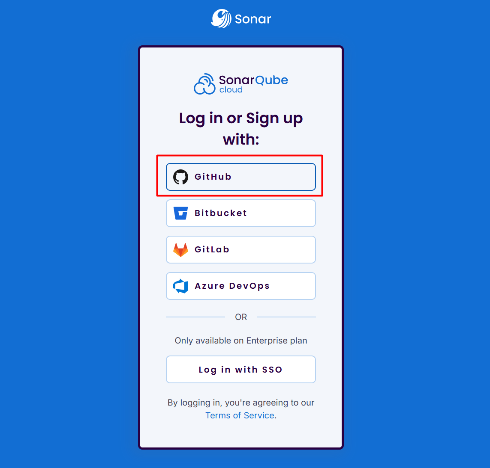
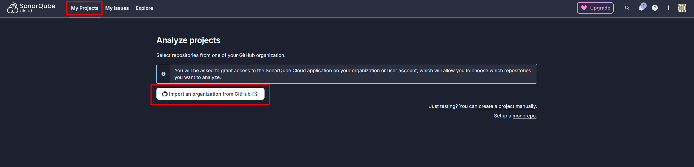
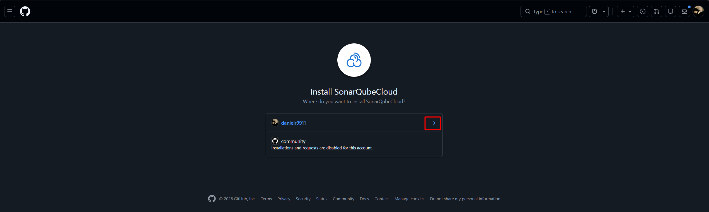
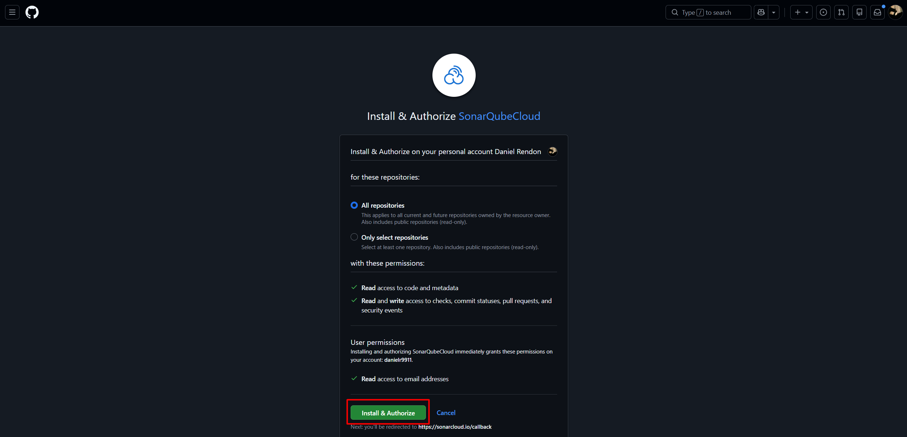
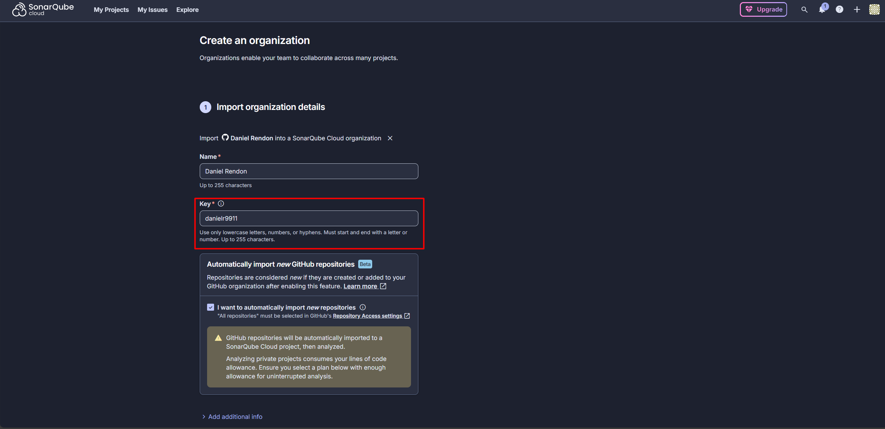
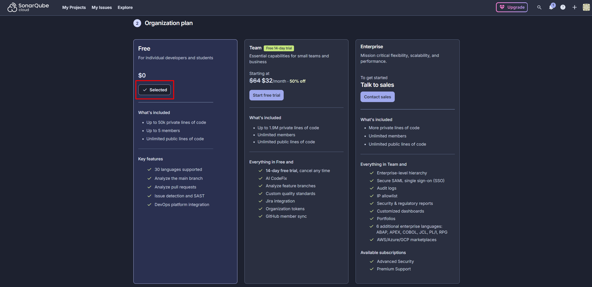
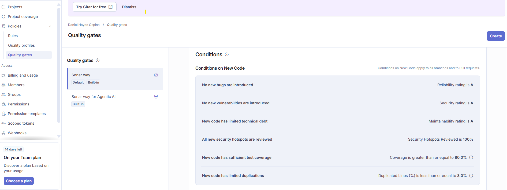
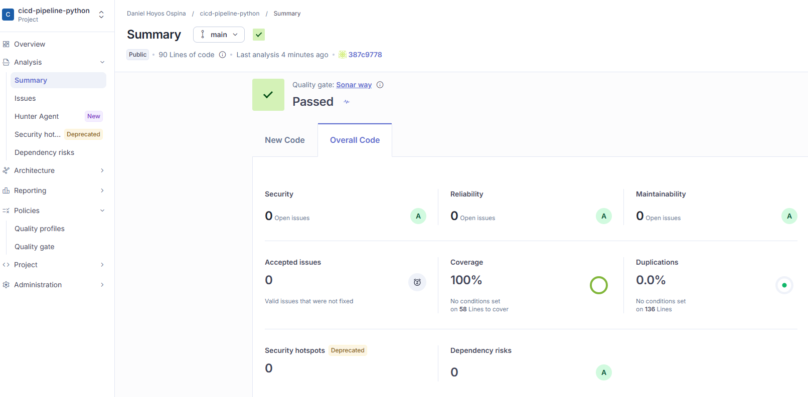

# Taller Entregable 2: Pipeline de CI con Python, GitHub Actions, Docker y Herramientas Open Source

En este taller construiremos un pipeline de Integración Continua (CI) para una aplicación Python simple, utilizando GitHub Actions, Docker y herramientas open source.  Aprenderás a:

*   Analizar la calidad y seguridad de tu código con Pylint, Flake8, Black y medir la cobertura con Coverage.py.
*   Integrar SonarCloud para análisis estático continuo, cobertura, seguridad y gates de calidad.
*   Escribir y ejecutar pruebas unitarias y de componente con pytest.
*   Automatizar pruebas de aceptación con Selenium y un headless browser, ejecutadas contra la imagen Docker de la aplicación.
*   Configurar un workflow de GitHub Actions que ejecute todas estas etapas en cada push a `main` y en cada Pull Request.
*   Usar variables de entorno y secretos de forma segura.
*   Crear una imagen Docker para tu aplicación.
*   Automatizar la publicación en Docker Hub de la imagen que pasó todas las validaciones.
*   Proteger la rama `main` para que los cambios solo entren mediante Pull Requests revisados y con el pipeline en verde.


**Nota:** No crearemos un release de un artefacto tradicional (zip, tar, etc.). Al final del pipeline generaremos una imagen Docker que encapsula nuestra aplicación y sus dependencias. Esta imagen podrá ser utilizada para despliegues consistentes en diferentes entornos y será publicada en Docker Hub, un registro público de imágenes Docker. Este enfoque nos prepara para el Taller 3, donde desplegaremos esa imagen.

**Niveles de prueba del taller:** 
*   **Unitarias** (`tests/test_calculadora.py`): prueban las funciones de la calculadora de forma aislada.
*   **De componente** (`tests/test_app.py`): prueban la aplicación Flask (rutas, lógica y plantilla HTML) con el cliente de pruebas de Flask, sin levantar un servidor ni un navegador. Algunos equipos las llaman pruebas de integración ligeras.
*   **De aceptación** (`tests/test_acceptance_app.py`): prueban la aplicación como lo haría un usuario, con un navegador real (Selenium) sobre la aplicación en ejecución dentro de su contenedor Docker.

No haremos pruebas de integración con servicios externos (bases de datos, APIs de terceros, etc.) porque esta aplicación no los utiliza.

## Prerrequisitos y modalidad de trabajo

**Modalidad e identificación:** Este taller se realiza en **equipos de 3 integrantes**, con **un único repositorio público** por equipo:

Una cantidad distinta de integrantes requiere autorización previa del docente; en ese caso se mantienen las mismas evidencias y se acuerda la distribución de roles.

*   Un integrante es el **propietario** del repositorio. Las cuentas de SonarCloud y Docker Hub que se usen en el taller son también las del propietario.
*   Los otros dos integrantes se agregan como **colaboradores** del repositorio (ver sección 3). Esto es necesario para que puedan crear ramas, abrir Pull Requests y aprobar los Pull Requests de sus compañeros.
*   Identifica a los 3 integrantes con sus nombres completos en la variable `AUTOR` de `app/calculadora.py` y en una sección **Integrantes** del `README.md`, con el mismo texto y en el mismo orden. Separa los nombres con ` | ` (espacio, barra vertical, espacio), igual que en el Taller 1. Ejemplo: `Ana María Pérez | Luis Andrés Gómez | Sara Restrepo Ríos`. En el README añade también el usuario de GitHub de cada integrante e indica quién es el propietario del repositorio. No incluyas credenciales ni datos personales adicionales.
*   **Forma de trabajo:** en las secciones 3 a 8 el equipo construye la base del proyecto directamente sobre `main` (todos pueden seguir los pasos en su equipo y hacer `git pull` para mantenerse sincronizados; coordínense para que un solo integrante haga push de cada cambio y evitar conflictos). En la sección 9 se protege `main` y, desde ese momento, **todo cambio entra mediante Pull Request**.

**Cuentas necesarias:**
*   Cuenta de **GitHub** de cada integrante.
*   Cuenta de **SonarCloud** del propietario (se crea iniciando sesión con GitHub, sección 5.2).
*   Cuenta de **Docker Hub** del propietario (sección 3.1).

**Herramientas locales (en el equipo de cada integrante):**
*   **Git**.
*   **Python 3.13** (la misma versión recomendada en el Taller 1 y la que usa el pipeline).
*   **[Docker Desktop (o Docker Engine)](https://docs.docker.com/get-started/get-docker/)** instalado y en ejecución.
*   **Google Chrome** para las pruebas de aceptación. Selenium descarga automáticamente el driver compatible con tu navegador (Selenium Manager); no necesitas instalarlo manualmente.
*   Un editor de código (por ejemplo, VS Code).

A lo largo del taller encontrarás **puntos de control (✅)**: verifica que se cumplen antes de continuar con la siguiente sección.

## 1. Introducción: ¿Qué es un Pipeline de CI?

Un pipeline de CI es un proceso automatizado que se ejecuta cada vez que se realizan cambios en el código de un repositorio.  Típicamente, un pipeline de CI incluye las siguientes etapas:

1.  **Code (Código):**  El desarrollador escribe código y lo sube al repositorio (usando Git, idealmente siguiendo un flujo de trabajo como Gitflow o Trunk-Based Development).

    **Gitflow** es un flujo de trabajo de Git que define una serie de ramas y reglas para gestionar el desarrollo de software de manera estructurada. Utiliza ramas principales como `main` y `develop`, y ramas de soporte como `feature`, `release`, y `hotfix` para organizar el trabajo en nuevas funcionalidades, preparaciones para lanzamientos y correcciones de errores críticos. Es especialmente adecuado para proyectos con ciclos de releases bien definidos y equipos que necesitan mantener múltiples versiones en producción simultáneamente.

    **Trunk-Based Development (TBD)** es un flujo de trabajo alternativo en el que todos los desarrolladores integran sus cambios directamente en una única rama principal (el "trunk", normalmente `main`). Las ramas de características son de muy corta duración (horas o pocos días) o se trabaja directamente en `main` usando *feature flags* para ocultar funcionalidad incompleta. Este enfoque favorece la integración continua real, reduce los conflictos de merge y acelera la entrega de valor, siendo la base de muchas prácticas DevOps modernas.

2.  **Build (Construcción):** Se compila el código (si es necesario), se instalan las dependencias y se prepara el entorno de ejecución. En Python, esta etapa a menudo implica crear un entorno virtual e instalar paquetes con `pip`. En este taller, también incluirá la construcción de una imagen Docker.

3.  **Test (Pruebas):**  Se ejecutan pruebas automatizadas para verificar que el código funciona correctamente y cumple con los requisitos de calidad.  Esto incluye:
    *   **Análisis de Calidad de Código:**  Herramientas que verifican el estilo del código, la complejidad, la presencia de errores potenciales, code smells y el cumplimiento de estándares (ej: PEP 8 en Python).
    *   **Pruebas Unitarias:**  Prueban unidades individuales de código (funciones, clases, métodos) de forma aislada.
    *   **Pruebas de Componente:** Prueban un componente completo de la aplicación (por ejemplo, las rutas web de Flask junto con su lógica y su plantilla) sin depender de servidores, navegadores ni servicios externos.
    *   **Pruebas de Aceptación (o Pruebas Funcionales/ en algunos lugares también las usan para E2E):**  Prueban la aplicación desde la perspectiva del usuario, simulando interacciones reales, usualmente a través de la interfaz de usuario (UI).

4.  **Release (Liberación):** Si todas las pruebas pasan, el código se considera apto para ser liberado. En un entorno de *Integración Continua*, esta etapa puede ser una verificación o la creación de un artefacto listo para desplegar. En este taller, esta etapa consistirá en publicar en Docker Hub la misma imagen Docker que pasó las pruebas, únicamente cuando el cambio ya está integrado en `main`.

## 2. Herramientas que Usaremos

*   **Python:**  Lenguaje de programación.
*   **GitHub Actions:**  Plataforma de CI/CD.
*   **Pylint:**  Analizador estático de código Python.  Detecta errores, problemas de estilo y código sospechoso.
*   **Flake8:**  Otra herramienta de análisis estático.  Combina PyFlakes (detección de errores lógicos), pycodestyle (verificación de estilo según PEP 8) y un detector de complejidad McCabe.
*   **Black:**  Formateador de código automático.  Aplica un estilo consistente a tu código.
*   **pytest:**  Framework para escribir y ejecutar pruebas unitarias, de componente y de aceptación.
*   **Coverage.py:** Mide la *cobertura de código* de tus pruebas unitarias (qué porcentaje de tu código está siendo ejecutado por las pruebas). Lo usaremos a través del plugin `pytest-cov`.
*   **Selenium:**  Framework para automatizar pruebas de aplicaciones web (pruebas de aceptación).  Permite simular la interacción de un usuario con un navegador. Incluye **Selenium Manager**, que descarga automáticamente el driver del navegador.
*   **SonarCloud:**  Plataforma *online* gratuita (para proyectos open source) para inspección continua de la calidad del código.  Se integra con GitHub Actions.
*   **Flask:** Microframework web de Python (para crear una aplicación web sencilla de ejemplo).
* **Docker:** Plataforma para desarrollar, desplegar y ejecutar aplicaciones en contenedores.
* **Docker Hub:** Un servicio de registro basado en la nube para construir y compartir imágenes de contenedores.

## 3. Configuración del Proyecto

1.  **Crea un nuevo repositorio público en GitHub (lo hace el propietario):**  Llámalo, por ejemplo, `cicd-pipeline-python`. Usa un nombre **en minúsculas**: el pipeline usará el nombre del repositorio como nombre de la imagen en Docker Hub, y Docker no acepta mayúsculas en ese nombre.

2.  **Agrega a tus compañeros como colaboradores (lo hace el propietario):** En el repositorio ve a **Settings → Collaborators → Add people**, busca el usuario de GitHub de cada compañero y envíale la invitación. Cada compañero debe **aceptar la invitación** (llega por correo y en las notificaciones de GitHub). Sin este paso no podrán hacer push de ramas ni aprobar Pull Requests en la sección 9.

3.  **Clona el repositorio a tu máquina local** (cada integrante).

4. **Crea un archivo `.gitignore` en la raíz de tu repositorio**:

    ```plaintext
    # virtual envs
    venv/
    env/

    # python
    *.pyc
    *.pyo
    *.pyd
    __pycache__/

    # pytest
    .pytest_cache/
    pytestdebug.log

    # coverage
    .coverage
    htmlcov/
    coverage.xml
    report.html
    acceptance-report.html

    # reportes de linters
    pylint-report.txt
    flake8-report.txt

    # IDE
    .vscode/
    ```

    Este archivo le dice a Git qué archivos y carpetas *no* debe incluir en el repositorio (por ejemplo, el entorno virtual, archivos de caché, reportes generados, archivos de configuración locales, etc.).

5.  **Crea un entorno virtual y activalo:**

    ```bash
    python -m venv venv      # En algunos SO puede ser python3
    # Si no funciona, instala virtualenv: pip install virtualenv y re-ejecuta.

    venv\Scripts\activate    # En Windows
    source venv/bin/activate # En Linux/macOS
    ```

    El entorno virtual aísla las dependencias del proyecto. Te debe aparecer `(venv)` en la terminal.

6. **Crea los archivos de dependencias en la raíz de tu repositorio:**

    Separaremos las dependencias en dos archivos:

    `requirements.txt` — lo que la aplicación necesita para **ejecutarse** (es lo único que se instalará en la imagen Docker):

    ```plaintext
    flask==3.1.3
    gunicorn==26.2.0
    ```

    `requirements-dev.txt` — lo que necesitamos para **desarrollar y validar** (linters y pruebas). La primera línea incluye también las dependencias de `requirements.txt`:

    ```plaintext
    -r requirements.txt
    pylint==4.1.3
    flake8==7.5.0
    black==26.10.1
    pytest==9.2.0
    pytest-cov==7.1.0
    pytest-html==4.2.0
    coverage==7.17.2
    selenium==4.52.0
    ```

    Fijamos versiones exactas (`==`) para que todos los integrantes y el pipeline usen las mismas herramientas. Así, por ejemplo, Black formatea igual en tu computador y en GitHub Actions, y una nueva versión de una librería no rompe el pipeline sin que nadie haya cambiado el código.

7.  **Instala las dependencias:**

    ```bash
    pip install -r requirements-dev.txt
    ```
    En la misma terminal donde activaste el entorno virtual.

8.  **Crea un archivo `Dockerfile` en la raíz de tu repositorio:**
    Este archivo contiene las instrucciones para construir la imagen Docker de tu aplicación.

    ```dockerfile
    # Dockerfile
    # Usa una imagen base oficial de Python. Elige una versión específica para consistencia.
    FROM python:3.13-slim

    # Establece el directorio de trabajo dentro del contenedor
    WORKDIR /app

    # Copia solo el archivo de requerimientos primero para aprovechar el cache de Docker
    COPY requirements.txt .

    # Instala solo las dependencias de ejecución (Flask y Gunicorn)
    # Usa --no-cache-dir para reducir el tamaño de la imagen
    RUN pip install --no-cache-dir -r requirements.txt

    # Copia el código de la aplicación (solo la carpeta app)
    COPY app/ ./app/

    # Expón el puerto en el que Gunicorn servirá la aplicación
    # Gunicorn por defecto usa 8000, así que usaremos ese.
    EXPOSE 8000

    # Comando para ejecutar la aplicación usando Gunicorn cuando el contenedor inicie
    # 'app.app:app' significa: del archivo app.py dentro del paquete app, usa la instancia 'app' de Flask.
    # 'workers=4' es un ejemplo, ajusta según sea necesario.
    # 'bind 0.0.0.0:8000' hace que Gunicorn escuche en todas las interfaces de red en el puerto 8000.
    CMD ["gunicorn", "--workers=4", "--bind=0.0.0.0:8000", "app.app:app"]
    ```
    Investiga qué hace cada instrucción (`FROM`, `WORKDIR`, `COPY`, `RUN`, `EXPOSE`, `CMD`) y por qué el orden de las capas (`COPY requirements.txt` antes de `COPY app/ ./app/`) es importante para la eficiencia de la construcción de la imagen. **Observa también que la imagen no incluye pruebas, linters ni Selenium: solo lo necesario para ejecutar la aplicación.**

9.  **Crea un archivo `.dockerignore` en la raíz de tu repositorio:**
    Similar a `.gitignore`, este archivo especifica qué archivos y directorios NO deben enviarse a Docker como contexto de construcción. Así la construcción es más rápida y evitamos copiar por error archivos locales.

    ```plaintext
    # .dockerignore
    .git
    .github
    venv
    env
    __pycache__
    *.pyc
    *.pyo
    *.pyd
    .pytest_cache
    htmlcov
    .coverage
    coverage.xml
    report.html
    acceptance-report.html
    pylint-report.txt
    flake8-report.txt
    .vscode
    tests
    ```

✅ **Punto de control:** tu repositorio tiene `.gitignore`, `requirements.txt`, `requirements-dev.txt`, `Dockerfile` y `.dockerignore`, y `pip install -r requirements-dev.txt` terminó sin errores. Tus dos compañeros aparecen como colaboradores del repositorio.

### 3.1. Crea una cuenta en Docker Hub

Docker Hub es el registro de imágenes Docker más popular. El propietario del repositorio necesitará una cuenta para que el pipeline de CI pueda publicar (hacer "push") la imagen Docker.

1.  **Ve a [https://hub.docker.com/](https://hub.docker.com/) y regístrate:** Haz clic en "Sign Up" y sigue las instrucciones. Necesitarás un nombre de usuario único (tu **Docker ID**), un correo electrónico y una contraseña.
2.  **Recuerda tu Docker ID:** Lo necesitarás más adelante para configurar las variables en GitHub y para etiquetar tu imagen Docker.
3.  **Verifica tu correo electrónico:** Completa el proceso de verificación si Docker Hub te lo solicita.

## 4. La Aplicación de Ejemplo (Calculadora Web)

Crearemos una aplicación web muy sencilla con Flask (una calculadora) para tener algo que probar a nivel unitario, de componente y de aceptación.

1.  **Crea una carpeta `app`**: Dentro de la carpeta raíz de tu proyecto (es decir `cicd-pipeline-python`)
2.  **Crea un archivo llamado `calculadora.py` dentro de la carpeta `app`**:

    ```python
    # app/calculadora.py

    # IMPORTANTE: reemplaza ??? con los nombres completos de los 3 integrantes,
    # separados por " | " y en el mismo orden de la sección Integrantes del README.
    # Ejemplo: "Ana María Pérez | Luis Andrés Gómez | Sara Restrepo Ríos"
    AUTOR = "???"

    def sumar(a, b):
        return a + b

    def restar(a, b):
        return a - b

    def multiplicar(a, b):
        return a * b

    def dividir(a, b):
        if b == 0:
            raise ZeroDivisionError("No se puede dividir por cero")
        return a / b
    ```
    Este archivo contiene las funciones de la calculadora.  Cada función toma dos números y realiza una operación matemática (suma, resta, multiplicación, división).  Si se intenta dividir por cero, se lanza una excepción `ZeroDivisionError`.

3.  **Crea un archivo `app.py` dentro de la carpeta `app`**:

    ```python
    # app/app.py
    from flask import Flask, render_template, request
    from .calculadora import sumar, restar, multiplicar, dividir

    app = Flask(__name__)

    @app.route("/", methods=["GET", "POST"])
    def index():
        resultado = None
        if request.method == "POST":
            try:
                num1 = float(request.form["num1"])
                num2 = float(request.form["num2"])
                operacion = request.form["operacion"]

                if operacion == "sumar":
                    resultado = sumar(num1, num2)
                elif operacion == "restar":
                    resultado = restar(num1, num2)
                elif operacion == "multiplicar":
                    resultado = multiplicar(num1, num2)
                elif operacion == "dividir":
                    resultado = dividir(num1, num2)
                else:
                    resultado = "Operación no válida"
            except ValueError:
                resultado = "Error: Introduce números válidos"
            except ZeroDivisionError:
                resultado = "Error: No se puede dividir por cero"

        return render_template("index.html", resultado=resultado)

    if __name__ == "__main__":  # pragma: no cover
        app.run(debug=True, port=5000, host='0.0.0.0') # Quita debug=True para producción
    ```
    Este archivo contiene la lógica de la aplicación web.  La función `index` maneja las peticiones GET y POST en la ruta raíz (`/`).  Si la petición es un POST, intenta obtener los números y la operación del formulario y llama a las funciones de la calculadora.  Luego, renderiza la plantilla `index.html` con el resultado.

4.  **Crea una carpeta `templates` dentro de la carpeta `app`**

5.  **Crea un archivo `templates/index.html` dentro de la carpeta `templates`:**

    ```html
    <!DOCTYPE html>
    <html>
    <head>
        <title>Calculadora</title>
    </head>
    <body>
        <h1>Calculadora</h1>
        <form method="post">
            <input type="text" name="num1" placeholder="Número 1" required>
            <input type="text" name="num2" placeholder="Número 2" required>
            <select name="operacion">
                <option value="sumar">Sumar</option>
                <option value="restar">Restar</option>
                <option value="multiplicar">Multiplicar</option>
                <option value="dividir">Dividir</option>
            </select>
            <button type="submit">Calcular</button>
        </form>
        
            <h2>Resultado: {{ resultado }}</h2>
        
    </body>
    </html>
    ```
    Este archivo es una plantilla HTML simple que muestra un formulario con dos campos de entrada (números) y un menú desplegable (operación).  Al enviar el formulario, muestra el resultado de la operación.

6.  **Crea un archivo `__init__.py` dentro de la carpeta `app`**:

    ```python
    # app/__init__.py
    # Archivo vacío para marcar 'app' como un paquete Python
    ```

7.  **Ejecuta la aplicación Flask (localmente para probar):**
    Parado en la raíz de tu repositorio, ejecuta:

    ```bash
    python -m app.app # en algunos SO, es python3 -m app.app
    ```

    Abre tu navegador y ve a [http://localhost:5000](http://localhost:5000).  Deberías ver la calculadora web.  Prueba a hacer algunas operaciones para asegurarte de que funciona correctamente.

    *Nota:*  Para detener la aplicación Flask, presiona `Ctrl+C` en la terminal.

### 4.1. Construcción y Prueba Local de la Imagen Docker

Antes de configurar el pipeline de CI completo, es una buena práctica verificar que tu `Dockerfile` funciona correctamente y que la aplicación se ejecuta como se espera dentro del contenedor Docker.

**Asegúrate de que Docker Desktop (o Docker Engine) esté en ejecución en tu máquina** (ver prerrequisitos).

1.  **Construye la imagen Docker localmente:**
    Abre tu terminal en la raíz del proyecto (donde están tu `Dockerfile` y la carpeta `app`) y ejecuta el siguiente comando:

    ```bash
    docker build -t mi-calculadora-local .
    ```
    * `docker build`: El comando para construir una imagen Docker.
    * `-t mi-calculadora-local`: La opción `-t` (tag) asigna un nombre y, opcionalmente, una etiqueta a la imagen. Aquí la llamamos `mi-calculadora-local` (puedes elegir otro nombre).
    * `.`: El punto al final indica que el contexto de construcción (los archivos necesarios para construir la imagen, incluyendo el `Dockerfile`) se encuentra en el directorio actual.

    Docker ejecutará los pasos definidos en tu `Dockerfile`, descargando la imagen base, instalando dependencias y copiando tu código.

    Si quieres ver las imágenes que has construido, puedes ejecutar:

    ```bash
    docker images
    ```

2.  **Ejecuta un contenedor a partir de la imagen:**
    Una vez construida la imagen, puedes crear y ejecutar un contenedor basado en ella:

    ```bash
    docker run -d --name calculadora-container -p 8080:8000 mi-calculadora-local
    ```
    * `docker run`: El comando para ejecutar un contenedor a partir de una imagen.
    * `-d`: (Detached) Ejecuta el contenedor en segundo plano, liberando tu terminal.
    * `--name calculadora-container`: Asigna un nombre fácil de recordar al contenedor en ejecución (`calculadora-container`). Esto facilita la gestión posterior (parar, eliminar, ver logs).
    * `-p 8080:8000`: (Publish) Mapea un puerto de tu máquina local (host) al puerto expuesto por el contenedor.
        * `8080`: El puerto en tu máquina local al que accederás (puedes usar otro si el 8080 está ocupado).
        * `8000`: El puerto *dentro* del contenedor que `gunicorn` está usando (según lo definido en el `EXPOSE` y `CMD` del `Dockerfile`).
    * `mi-calculadora-local`: El nombre de la imagen que construiste en el paso anterior y desde la cual quieres crear el contenedor.

3.  **Verifica la aplicación en el navegador:**
    Abre tu navegador web y navega a `http://localhost:8080` (o el puerto que hayas elegido en el `-p`). Deberías ver tu aplicación de calculadora funcionando exactamente igual que cuando la ejecutaste con `python -m app.app`, pero esta vez está corriendo dentro de un contenedor Docker aislado. Realiza algunas operaciones para confirmar que todo funciona.

4.  **Detén y elimina el contenedor (limpieza):**
    Cuando hayas terminado de probar, es bueno detener y eliminar el contenedor para liberar recursos:

    ```bash
    docker stop calculadora-container
    docker rm calculadora-container
    ```
    * `docker stop`: Detiene el contenedor especificado por su nombre.
    * `docker rm`: Elimina el contenedor detenido especificado por su nombre.

    Este ciclo de construir, ejecutar y probar localmente te permite depurar tu `Dockerfile` y asegurarte de que tu aplicación está correctamente empaquetada antes de integrarla en el pipeline de CI/CD.

✅ **Punto de control:** la calculadora funciona con `python -m app.app` en `http://localhost:5000` y también dentro del contenedor en `http://localhost:8080`.


## 5. Análisis de Calidad de Código

### 5.1. Pylint, Flake8 y Black (Local)

1.  **Ejecuta Pylint:**

    ```bash
    pylint app
    ```

    Verás un informe con los problemas encontrados (si los hay) y una puntuación sobre 10.  Presta atención a los errores (E), warnings (W), convenciones (C) y refactorizaciones (R).
    Con el código inicial la puntuación será menor a 10 (por ejemplo, por funciones sin docstring). Es normal: en el pipeline Pylint **no detendrá** el proceso por estos hallazgos; generará un reporte que SonarCloud importará, y será el Quality Gate de SonarCloud el que decida si el código cumple (ver sección 8).
    No corrijas aún los problemas, solo observa el informe.

2.  **Crea un archivo `.flake8` en la raíz de tu repositorio y ejecuta Flake8:**

    Black (paso 3) y Flake8 tienen reglas por defecto que se contradicen: Black permite líneas de hasta 88 caracteres y Flake8 solo hasta 79, y Black da formato a ciertos espacios (por ejemplo, antes de `:` en slices) que Flake8 reporta como error (E203). Esta configuración, recomendada en la documentación de Black, los hace compatibles:

    ```ini
    [flake8]
    max-line-length = 88
    extend-ignore = E203,E701
    ```

    Luego ejecuta:

    ```bash
    flake8 app
    ```

    Flake8 mostrará errores de estilo (según PEP 8) y otros problemas de calidad de código.  Presta atención a los errores. No corrijas aún los problemas, solo observa el informe.

3.  **Ejecuta Black:**

    ```bash
    black app
    ```

    Black reformateará tu código automáticamente para que cumpla con un estilo consistente.  **Después de ejecutar Black, vuelve a ejecutar Pylint y Flake8** para ver si los problemas de estilo han desaparecido. ¿Algunos desaparecieron? y ¿la puntuación de pylint subió? ¿verdad?, Black es una herramienta muy útil para mantener un estilo de código consistente.

    No corrijas aún el resto de problemas, solo observa el informe.

    **Importante:**  Es una buena práctica ejecutar estas herramientas *antes* de hacer un commit. En particular, en el pipeline Black se ejecuta en modo verificación (`black app --check`) y **sí detiene** el pipeline si encuentra código sin formatear; basta con ejecutar `black app` antes de cada commit para evitarlo.

    **Tip:** Investiga que es un *pre-commit hook* y cómo configurarlo para que Black u otros linters cómo flake8 y pylint se ejecuten automáticamente antes de cada commit.

✅ **Punto de control:** `black app --check` indica que no hay archivos por reformatear, y `pylint app` y `flake8 app` se ejecutan sin errores de configuración (pueden reportar hallazgos; los corregirás en la sección 8).

### 5.2. Integración con SonarCloud (Análisis Estático Continuo)

SonarCloud es una plataforma en la nube que proporciona análisis estático continuo de código.  Es gratuita para proyectos de código abierto y se integra muy bien con GitHub Actions.
La idea con esta herramienta es que puedas tener un análisis continuo de la calidad de tu código, detectando problemas de seguridad, bugs, code smells y duplicación de código.
SonarCloud tomará los informes de Pylint, Flake8 y Coverage.py y los mostrará en un panel de control fácil de entender.

Los pasos 1 a 5 de esta sección los realiza el **propietario** del repositorio.

1.  **Crea una cuenta en SonarCloud:**  Ve a [https://sonarcloud.io/](https://sonarcloud.io/) y regístrate con tu cuenta de GitHub.

2.  **Crea una organización:** 
    * Da click en "Import an organization".
    

    * Luego selecciona tu cuenta de Github. 
    

    * Selecciona All repositories y da click en "Install".
    

    * Crea tu organización (nombre e identificador único), selecciona el plan gratuito y da click en **crear** organización. **Recuerda el nombre de tu organización (Key), lo necesitarás más adelante.**
    
    

3.  **Importa tu repositorio:**
    *   Haz clic  'My Projects' y selecciona "Analyze a new project".
    *   Selecciona tu repositorio (`cicd-pipeline-python`) y dale click en `Set Up`.
    *   Define qué se considera **código nuevo** (*New Code*). Puedes dejar la opción por defecto, **"Previous version"**, o elegir **"Number of days"** con el valor **30** (si la interfaz te lo permite) para analizar el código escrito en los últimos 30 días. Para este taller ambas opciones son válidas: en el primer análisis todo el código cuenta como nuevo y los criterios de calificación se miden sobre **Overall Code**. Si no te aparece la opción de días, no te preocupes: no afecta el resultado.
    *   SonarCloud analizará tu repositorio y te mostrará un panel de control con los resultados.  Inicialmente, puede que no muestre mucha información porque no hemos configurado el análisis en el workflow.

    > **⚠️ Importante — Deshabilita el Análisis Automático:** Una vez importado el proyecto, debes deshabilitar el análisis automático de SonarCloud para evitar duplicidad y errores con el análisis que realizará GitHub Actions. Ve a **Administration → Analysis Method** dentro de tu proyecto en SonarCloud y desactiva la opción **"Automatic Analysis"**. Si no haces esto, SonarCloud intentará analizar el código por su cuenta *además* del análisis lanzado desde el pipeline, lo que puede generar conflictos y resultados incorrectos.

    > **🌐 Importante — Haz tu proyecto público en SonarCloud:** Ve a **Administration → Permissions** dentro de tu proyecto en SonarCloud y, en **Project visibility**, selecciona **"Public - Anyone"**. Esto es necesario para que el proyecto pueda ser revisado sin necesidad de iniciar sesión. Si el proyecto es privado, no podrá ser calificado.

4.  **Obtén tu token de SonarCloud:**
    *   Ve a "My Account" (en la esquina superior derecha).
    *   Ve a la pestaña "Access Tokens".
    *   Genera un token (dale un nombre, por ejemplo, "GitHub Actions Token").  *Copia este token*.  Lo necesitarás en el siguiente paso.

5.  **Crea los secretos y variables en GitHub:**

    Primero, genera el token de acceso de Docker Hub (lo necesitas en este mismo paso, así evitas tenerlo anotado en un lugar inseguro):
    *   Inicia sesión en [Docker Hub](https://hub.docker.com/).
    *   Ve a tu **Account Settings → Personal Access Tokens**.
    *   Haz clic en "Generate new token".
    *   Dale un nombre descriptivo (ej: `github-actions-cicd-pipeline`) y define los permisos (ej: "Read & Write").
    *   Haz clic en "Generate" y **copia el token inmediatamente**. No podrás verlo de nuevo.

    Ahora configura los **secretos** en GitHub (para valores sensibles que nunca deben quedar expuestos):
    *   Ve a tu repositorio en GitHub (`cicd-pipeline-python`) > **Settings > Secrets and variables > Actions > New repository secret**.
    *   Crea los siguientes **2 secretos**:
        * **`SONAR_TOKEN`:** Pega el token que copiaste de SonarCloud.
        * **`DOCKERHUB_TOKEN`:** Pega el **Token de Acceso** que acabas de generar en Docker Hub.

    A continuación configura las **variables** en GitHub (para valores de configuración no sensibles):
    *   En la misma sección **Settings > Secrets and variables > Actions**, haz clic en la pestaña **"Variables"** y luego en **"New repository variable"**.
    *   Crea las siguientes **2 variables**:
        * **`DOCKERHUB_USERNAME`:** Pon tu **Docker ID** (tu nombre de usuario en Docker Hub).
        * **`SONAR_HOST_URL`:** Pon `https://sonarcloud.io`.

    > **¿Por qué separar secretos de variables?** Los **secretos** (`secrets.*`) están cifrados y GitHub intenta enmascararlos en los logs, pero no debes imprimirlos: transformarlos o escribirlos en archivos puede exponerlos. Las **variables** (`vars.*`) son configuración no sensible y pueden aparecer en los logs. `DOCKERHUB_USERNAME` y `SONAR_HOST_URL` no son datos sensibles, por lo que es más correcto y transparente tratarlos como variables de configuración.

6.  **Crea un archivo `sonar-project.properties` en la raíz de tu repositorio:** Este archivo le dice a SonarCloud cómo analizar tu proyecto.

    ```properties
    sonar.projectKey=[TU_USUARIO]_cicd-pipeline-python
    sonar.organization=[TU_ORGANIZACION]
    sonar.sources=app
    sonar.python.version=3.13
    sonar.python.pylint.reportPaths=pylint-report.txt
    sonar.python.flake8.reportPaths=flake8-report.txt
    sonar.coverage.exclusions=**/tests/**,**/setup.py,app/__init__.py
    sonar.python.coverage.reportPaths=coverage.xml
    sonar.qualitygate.wait=true
    sonar.qualitygate.timeout=300
    ```
     **Importante:**
    *   Reemplaza `[TU_USUARIO]` con el *nombre de usuario de GitHub del propietario del repositorio*. **Si tu repositorio no se llama `cicd-pipeline-python`, reemplaza también `cicd-pipeline-python` con el nombre de tu repositorio o proyecto en SonarCloud**. Lo más seguro es copiar el **Project Key** exacto desde SonarCloud (**Information** del proyecto).
    *   Reemplaza `[TU_ORGANIZACION]` con el *nombre o Key de tu organización en SonarCloud* (que puede ser diferente a tu nombre de usuario de GitHub, pero **USUALMENTE es el mismo usuario de Github si no cambiaste nada al crear la organización en SonarCloud**).
    *   `sonar.sources=app`:  Esto le dice a SonarCloud que solo analice el código dentro de la carpeta `app`.  Si tuvieras código en otros directorios, los añadirías aquí (separados por comas).
    *   `sonar.python.version=3.13`:  Indica la versión de Python que estás utilizando.
    *   `sonar.python.pylint.reportPaths=pylint-report.txt`:  Le dice a SonarCloud dónde encontrar el informe de Pylint.
    *   `sonar.python.flake8.reportPaths=flake8-report.txt`:  Le dice a SonarCloud dónde encontrar el informe de Flake8.
    *   `sonar.coverage.exclusions=**/tests/**,**/setup.py,app/__init__.py`:  Excluye los archivos de prueba, el init y el archivo `setup.py` de la cobertura de código.
    *   `sonar.python.coverage.reportPaths=coverage.xml`:  Le dice a SonarCloud dónde encontrar el informe de cobertura de código.
    *   `sonar.qualitygate.wait=true`:  Espera a que se complete el análisis antes de aplicar el Quality Gate. El quality gate es un conjunto de condiciones que tu código debe cumplir para ser considerado "bueno" (por ejemplo, un mínimo de cobertura de código, un máximo de errores, etc.). Si no se cumple el Quality Gate, el análisis fallará. El quality gate que tenemos establecido es el por defecto de SonarCloud (*Sonar way*), que puedes ver en **Policies → Quality gate** dentro de tu proyecto:
    
    *   `sonar.qualitygate.timeout=300`:  Tiempo máximo de espera para el Quality Gate (en segundos).

## 6. Pruebas Unitarias y de Componente con pytest y Cobertura

1.  Crea un directorio llamado `tests` en la raíz de tu proyecto.

2.  Dentro de `tests`, crea un archivo llamado `test_calculadora.py`:

    ```python
    # tests/test_calculadora.py
    import pytest
    from app.calculadora import sumar, restar, multiplicar, dividir

    def test_sumar():
        assert sumar(2, 3) == 5
        assert sumar(-1, 1) == 0
        assert sumar(0, 0) == 0

    def test_restar():
        assert restar(5, 2) == 3
        assert restar(1, -1) == 2
        assert restar(0, 0) == 0

    def test_multiplicar():
        assert multiplicar(2, 3) == 6
        assert multiplicar(-1, 5) == -5
        assert multiplicar(0, 10) == 0

    def test_dividir():
        assert dividir(10, 2) == 5.0
        assert dividir(5, -1) == -5.0
        with pytest.raises(ZeroDivisionError):
            dividir(1, 0)
    ```

    Estas pruebas **unitarias** verifican que las funciones de la calculadora (`sumar`, `restar`, `multiplicar`, `dividir`) funcionen correctamente de forma aislada, sin servidor web ni navegador.  Cada prueba verifica varios casos (números positivos, negativos, cero, división por cero).

3. Dentro de `tests` crea un archivo llamado `test_app.py`:

    ```python
    # tests/test_app.py
    import pytest
    from app.app import app

    @pytest.fixture
    def client():
        app.config['TESTING'] = True
        with app.test_client() as client:
            yield client

    def test_index_get(client):
        response = client.get('/')
        assert response.status_code == 200
        assert b'<!DOCTYPE html>' in response.data  # Assuming the HTML template starts with <!DOCTYPE html>

    def test_index_post_sumar(client):
        response = client.post('/', data={'num1': '2', 'num2': '3', 'operacion': 'sumar'})
        assert response.status_code == 200
        assert b'Resultado: 5.0' in response.data

    def test_index_post_restar(client):
        response = client.post('/', data={'num1': '5', 'num2': '3', 'operacion': 'restar'})
        assert response.status_code == 200
        assert b'Resultado: 2.0' in response.data

    def test_index_post_multiplicar(client):
        response = client.post('/', data={'num1': '2', 'num2': '3', 'operacion': 'multiplicar'})
        assert response.status_code == 200
        assert b'Resultado: 6.0' in response.data

    def test_index_post_dividir(client):
        response = client.post('/', data={'num1': '6', 'num2': '3', 'operacion': 'dividir'})
        assert response.status_code == 200
        assert b'Resultado: 2.0' in response.data

    def test_index_post_dividir_by_zero(client):
        response = client.post('/', data={'num1': '6', 'num2': '0', 'operacion': 'dividir'})
        assert response.status_code == 200
        assert b'Error: No se puede dividir por cero' in response.data

    def test_index_post_invalid_operation(client):
        response = client.post('/', data={'num1': '6', 'num2': '3', 'operacion': 'invalid'})
        assert response.status_code == 200
        assert b'Operaci\xc3\xb3n no v\xc3\xa1lida' in response.data

    def test_index_post_invalid_numbers(client):
        response = client.post('/', data={'num1': 'a', 'num2': 'b', 'operacion': 'sumar'})
        assert response.status_code == 200
        assert b'Error: Introduce n\xc3\xbameros v\xc3\xa1lidos' in response.data
    ```

    Estas pruebas de **componente** verifican la aplicación web Flask (`app.py`) completa —rutas, formulario, plantilla HTML y calculadora juntas— usando el cliente de pruebas de Flask, que simula peticiones HTTP sin levantar un servidor real. Verifican que la página de inicio (`/`) responda correctamente a las peticiones GET y POST, y que el resultado mostrado sea el correcto. Comprobamos el texto completo (`Resultado: 5.0`) y no solo el número, para evitar que la prueba pase por coincidencia con otro texto de la página.
    
    El método marcado con `@pytest.fixture` es un *fixture* (una función que se ejecuta antes y después de las pruebas).  En este caso, `client` es un *fixture* que crea un cliente de prueba para la aplicación Flask.

    Luego, hay varias pruebas que verifican diferentes escenarios (GET, POST con diferentes operaciones y números).  Por ejemplo, `test_index_post_sumar` verifica que la suma de 2 y 3 devuelva 5.

4. Crea un archivo `pytest.ini` en la raíz de tu repositorio para configurar pytest:

    ```ini
    # pytest.ini
    [pytest]
    pythonpath = .  
    addopts = -v --color=yes --tb=short --cov=app --cov-report=term-missing --cov-report=html --cov-report=xml --cov-branch --html=report.html --self-contained-html
    testpaths = tests
    norecursedirs = .git venv env .* _* build dist htmlcov .github
    ```

    Esta configuración le dice a pytest que busque pruebas en los directorios `tests`, y que mida la cobertura de código en la carpeta `app`.  También le dice a pytest que genere informes HTML y XML de la cobertura.

    *  **`pythonpath = .`:**  Añade el directorio raíz a `sys.path` para que pytest pueda encontrar los módulos de tu aplicación.
    *  **`addopts = ...`:**  Opciones adicionales para pytest.  `-v` es para verbose, `--color=yes` para colores en la consola, `--tb=short` para mostrar solo la parte relevante de los errores, `--cov=app` para medir la cobertura del código en la carpeta `app`, `--cov-report=term-missing` para mostrar las líneas no cubiertas en la consola, `--cov-report=html` para generar un informe HTML, `--cov-report=xml` para generar un informe XML, `--cov-branch` para incluir la cobertura de ramas, `--html=report.html` para generar un informe HTML de las pruebas, y `--self-contained-html` para que el informe HTML sea autónomo (sin dependencias externas).
    *  **`testpaths = tests`:**  Indica a pytest que busque pruebas en los directorios `tests`.
    *  **`norecursedirs = ...`:**  Excluye ciertos directorios de la búsqueda de pruebas.


5.  **Ejecuta las pruebas y mide la cobertura (localmente):**

    ```bash
    pytest --ignore=tests/test_acceptance_app.py --cov-fail-under=80
    ```

    pytest buscará automáticamente archivos que comiencen con `test_` o terminen con `_test` y ejecutará las funciones que comiencen con `test_`. Usamos exactamente el mismo comando que ejecutará el pipeline:

    * `--ignore=tests/test_acceptance_app.py` excluye las pruebas de aceptación (sección 7), que necesitan la aplicación en ejecución y un navegador. Aquí solo corren las pruebas unitarias y de componente.
    * `--cov-fail-under=80` hace que el comando **falle si la cobertura total es menor al 80%**, aunque todas las pruebas pasen. Es el umbral mínimo de cobertura del taller.
    * El resumen de las pruebas, su resultado y la cobertura de código se mostrarán en la consola.
    * Con la configuración establecida en el pytest.ini, se genera un informe HTML detallado en una carpeta llamada `htmlcov`. Puedes abrir `htmlcov/index.html` en tu navegador para ver la cobertura línea por línea.
    * También puedes revisar el `report.html` generado por pytest, que contiene un resumen de las pruebas y su resultado.  Puedes abrir `report.html` en tu navegador para ver el informe.
    * También se genera `coverage.xml`, el archivo que SonarCloud usará para mostrar la cobertura.

    > **¿Por qué el umbral está en pytest y no solo en SonarCloud?** El Quality Gate por defecto de SonarCloud exige 80% de cobertura solo sobre el **código nuevo**, y no evalúa la cobertura cuando el cambio es muy pequeño (menos de 20 líneas). Con `--cov-fail-under=80` garantizamos que la cobertura **total** nunca baje del 80% en ningún cambio, y el pipeline falla rápido, antes de construir la imagen.

✅ **Punto de control:** las 12 pruebas pasan y la cobertura total es mayor o igual al 80%.

## 7. Pruebas de Aceptación con Selenium

Las pruebas de aceptación simulan la interacción de un usuario real con la aplicación, normalmente a través de la interfaz de usuario (en nuestro caso, la página web de la calculadora).  Selenium es un framework que permite automatizar esta interacción.

Dada la naturaleza de las pruebas de aceptación (que requieren la aplicación en ejecución), es necesario instanciar el aplicativo antes de ejecutar las pruebas.  Localmente ejecutaremos la aplicación Flask con `python -m app.app` (puerto 5000). En el pipeline (sección 8) las ejecutaremos contra el **contenedor Docker** de la aplicación (puerto 8000), es decir, contra la misma imagen que luego se publicará.

1.  Crea un archivo llamado `tests/test_acceptance_app.py`:

    ```python
    # tests/test_acceptance_app.py
    import os

    import pytest
    from selenium import webdriver
    from selenium.webdriver.common.by import By
    from selenium.webdriver.support import expected_conditions as EC
    from selenium.webdriver.support.ui import Select, WebDriverWait

    BASE_URL = os.environ.get("APP_BASE_URL", "http://localhost:5000")


    # Configuración del driver (elige uno: Chrome o Firefox)
    @pytest.fixture
    def browser():
        # Opción 1: Chrome (headless - sin interfaz gráfica)
        options = webdriver.ChromeOptions()
        options.add_argument("--headless")  # Ejecuta sin interfaz gráfica
        options.add_argument("--no-sandbox")  # Necesario para algunos entornos
        options.add_argument("--disable-dev-shm-usage")  # Necesario para algunos entornos
        driver = webdriver.Chrome(options=options)

        # Opción 2: Firefox (headless)
        # options = webdriver.FirefoxOptions()
        # options.add_argument("--headless")
        # driver = webdriver.Firefox(options=options)

        yield driver
        driver.quit()


    # Función de ayuda: espera hasta 10 segundos a que el <h2> sea visible y devuelve su texto.
    # Si no aparece, Selenium lanza TimeoutException y la prueba falla mostrando la causa.
    def get_resultado(browser):
        resultado = WebDriverWait(browser, 10).until(
            EC.visibility_of_element_located((By.TAG_NAME, "h2"))
        )
        return resultado.text


    # Función de ayuda para encontrar los elementos del formulario
    def find_elements(browser):
        num1_input = browser.find_element(By.NAME, "num1")
        num2_input = browser.find_element(By.NAME, "num2")
        operacion_select = Select(browser.find_element(By.NAME, "operacion"))
        calcular_button = browser.find_element(By.CSS_SELECTOR, "button[type='submit']")
        return num1_input, num2_input, operacion_select, calcular_button


    @pytest.mark.parametrize(
        "num1, num2, operacion, resultado_esperado",
        [
            ("2", "3", "sumar", "Resultado: 5.0"),
            ("5", "2", "restar", "Resultado: 3.0"),
            ("4", "6", "multiplicar", "Resultado: 24.0"),
            ("10", "2", "dividir", "Resultado: 5.0"),
            ("5", "0", "dividir", "Resultado: Error: No se puede dividir por cero"),
            ("abc", "def", "sumar", "Resultado: Error: Introduce números válidos"),
        ],
    )
    def test_calculadora(browser, num1, num2, operacion, resultado_esperado):
        browser.get(BASE_URL)

        num1_input, num2_input, operacion_select, calcular_button = find_elements(browser)

        num1_input.send_keys(num1)
        num2_input.send_keys(num2)
        operacion_select.select_by_value(operacion)
        calcular_button.click()

        # Compara el texto completo: "Resultado: 5.0" no debe aceptar "Resultado: 50.0"
        assert get_resultado(browser) == resultado_esperado
    ```

2.  **Ejecuta las pruebas de aceptación (localmente):**

    Para ejecutar las pruebas de aceptación *localmente*, primero necesitas ejecutar tu aplicación Flask:

    ```bash
    python -m app.app
    ```
    Luego, en *otra* terminal (manteniendo la aplicación Flask en ejecución):
    ```bash
    # activa el entorno virtual
    venv\Scripts\activate     # En Windows
    source venv/bin/activate  # En Linux/macOS
    
    pytest tests/test_acceptance_app.py --no-cov --html=acceptance-report.html
    ```

    *   `--no-cov` desactiva la medición de cobertura para esta ejecución. Las pruebas de aceptación controlan un navegador que habla con un servidor en otro proceso, así que no miden la cobertura del código de `app`; además, así no se sobrescribe el `coverage.xml` generado por las pruebas unitarias y de componente.
    *   `--html=acceptance-report.html` genera un reporte separado para las pruebas de aceptación (sin sobrescribir `report.html`).

**Explicación del código de prueba de aceptación:**

*   **`import pytest`:** Importa el framework pytest.
*   **`from selenium import webdriver`:** Importa las clases necesarias de Selenium. Desde Selenium 4.6, **Selenium Manager** descarga automáticamente el driver compatible con tu navegador, por eso no necesitamos `webdriver-manager`.
*   **`from selenium.webdriver.common.by import By`:** Importa `By` para seleccionar elementos por diferentes criterios (nombre, ID, CSS selector, etc.).
*  **`from selenium.webdriver.support.ui import Select, WebDriverWait`:** Importa `Select` para manejar elementos `select` (menús desplegables) y `WebDriverWait` para esperar a que aparezcan elementos en la página.
*   **`from selenium.webdriver.support import expected_conditions as EC`:** Importa `expected_conditions` para definir condiciones de espera.
*   **`BASE_URL`:**  La URL base de la aplicación.  Se toma de la variable de entorno `APP_BASE_URL` o usa `http://localhost:5000` por defecto. El pipeline la cambia a `http://localhost:8000` para probar el contenedor.
*   **`@pytest.fixture`:**  Un *fixture* es una función que se ejecuta antes y después de las pruebas.  En este caso, `browser` es un *fixture* que crea un nuevo navegador headless (Chrome, o Firefox si cambias la opción) antes de cada prueba y lo cierra después.
*   **`def get_resultado(browser):`**  Una función auxiliar que espera a que aparezca el resultado en la página y lo devuelve.  Si el resultado no aparece en 10 segundos, Selenium lanza un `TimeoutException` y la prueba falla con un mensaje claro de la causa.
*   **`def find_elements(browser):`**  Una función auxiliar que busca los elementos de la página (números, operación, botón) y los devuelve.
*   **`@pytest.mark.parametrize`:**  Un decorador que permite ejecutar la misma prueba con diferentes datos de entrada.  En este caso, probamos varias operaciones con diferentes números y comprobamos que el resultado sea el esperado.
*   **`browser.get(BASE_URL)`:**  Abre la página de la calculadora web en el navegador.
*   **`num1_input, num2_input, operacion_select, calcular_button = find_elements(browser)`:**  Usa la función auxiliar para encontrar los elementos de la página.
*   **`num1_input.send_keys(num1)`:**  Escribe el primer número en el campo de entrada.
*   **`operacion_select.select_by_value(operacion)`:**  Selecciona la operación en el menú desplegable.
*   **`calcular_button.click()`:**  Hace clic en el botón de calcular.
*   **`assert get_resultado(browser) == resultado_esperado`:**  Comprueba que el texto mostrado sea **exactamente** el esperado. Una comparación parcial (`in`) podría aceptar resultados incorrectos; por ejemplo, `"Resultado: 5"` está contenido en `"Resultado: 50.0"`.

**Resumen de comandos de prueba del taller:**

| Pruebas | Comando | Requiere la app en ejecución |
|---|---|---|
| Unitarias y de componente (con cobertura ≥ 80%) | `pytest --ignore=tests/test_acceptance_app.py --cov-fail-under=80` | No |
| Aceptación | `pytest tests/test_acceptance_app.py --no-cov --html=acceptance-report.html` | Sí (local: puerto 5000; pipeline: contenedor en puerto 8000) |

✅ **Punto de control:** con la aplicación en ejecución, las 6 pruebas de aceptación pasan.


## 8. GitHub Actions Workflow (CI Pipeline)

Ahora, vamos a crear el archivo YAML que define nuestro pipeline de CI en GitHub Actions. Cada vez que se haga un push a la rama `main` o se abra (o actualice) un Pull Request hacia `main`, GitHub Actions:

1.  Verificará el formato (Black) y generará los reportes de los linters (Pylint y Flake8).
2.  Ejecutará las pruebas unitarias y de componente, exigiendo una cobertura mínima del 80%.
3.  Construirá la imagen Docker **una sola vez**, la ejecutará y correrá las pruebas de aceptación (Selenium) **contra ese contenedor**.
4.  Enviará los reportes a SonarCloud y esperará el resultado del Quality Gate.
5.  **Solo en un push a `main`** (es decir, cuando el cambio ya fue integrado), publicará en Docker Hub **exactamente la misma imagen que fue probada**.

En un Pull Request se ejecutan los pasos 1 a 4, pero la imagen no se publica: así validamos el cambio antes de integrarlo.

1.  Crea el archivo `.github/workflows/ci.yml`:

    ```yaml
    name: CI Pipeline

    on:
      push:
        branches:
          - main
      pull_request:
        branches:
          - main
      workflow_dispatch:

    permissions:
      contents: read

    jobs:
      build-and-test:  # No cambies este nombre: la regla de protección de la sección 9 lo usa
        runs-on: ubuntu-latest
        env:
          # Nombre de la imagen: <usuario de Docker Hub>/<nombre del repositorio>
          IMAGE_NAME: ${{ vars.DOCKERHUB_USERNAME }}/${{ github.event.repository.name }}

        steps:
          - name: Checkout
            uses: actions/checkout@v7
            with:
              fetch-depth: 0  # Historial completo: SonarCloud lo usa para identificar el código nuevo

          - name: Set up Python
            uses: actions/setup-python@v7
            with:
              python-version: '3.13'

          - name: Install dependencies
            run: |
              python -m pip install --upgrade pip
              pip install -r requirements-dev.txt

          - name: Run Black (Formatter)
            run: black app --check  # --check solo verifica, no modifica

          - name: Run Pylint (Linter)
            run: pylint app --exit-zero --output-format=text > pylint-report.txt

          - name: Run Flake8 (Linter)
            run: flake8 app --exit-zero --output-file=flake8-report.txt

          - name: Run Unit and Component Tests
            run: pytest --ignore=tests/test_acceptance_app.py --cov-fail-under=80

          - name: Build Docker image
            run: docker build -t "$IMAGE_NAME:${{ github.sha }}" .

          - name: Start container
            run: |
              docker run -d --name calculadora -p 8000:8000 "$IMAGE_NAME:${{ github.sha }}"
              # Espera hasta 30 segundos a que la aplicación responda
              timeout 30 bash -c 'until curl -sf http://localhost:8000 > /dev/null; do sleep 1; done'

          - name: Run Acceptance Tests
            env:
              APP_BASE_URL: http://localhost:8000
            run: pytest tests/test_acceptance_app.py --no-cov --html=acceptance-report.html

          - name: Show container logs on failure
            if: failure()
            run: docker logs calculadora || true

          - name: Upload Test Reports Artifacts
            if: always()
            uses: actions/upload-artifact@v7
            with:
              name: test-reports
              path: |
                htmlcov/
                report.html
                acceptance-report.html
                coverage.xml
                pylint-report.txt
                flake8-report.txt

          - name: SonarCloud Scan
            uses: SonarSource/sonarqube-scan-action@v8
            env:
              SONAR_TOKEN: ${{ secrets.SONAR_TOKEN }}    # El secreto que creaste
              SONAR_HOST_URL: ${{ vars.SONAR_HOST_URL }} # La variable que configuraste

          # --- Publicación: solo cuando el cambio ya está integrado en main ---

          - name: Login to Docker Hub
            if: github.event_name == 'push' && github.ref == 'refs/heads/main'
            uses: docker/login-action@v4
            with:
              username: ${{ vars.DOCKERHUB_USERNAME }}
              password: ${{ secrets.DOCKERHUB_TOKEN }}

          - name: Push Docker image
            if: github.event_name == 'push' && github.ref == 'refs/heads/main'
            run: |
              docker tag "$IMAGE_NAME:${{ github.sha }}" "$IMAGE_NAME:latest"
              docker push "$IMAGE_NAME:${{ github.sha }}"
              docker push "$IMAGE_NAME:latest"
    ```

**Explicación del Workflow:**

*   **`name`:** Nombre del workflow.
*   **`on`:**  Se ejecuta en `push` a `main`, en `pull_request` hacia `main`, y manualmente (`workflow_dispatch`).
*   **`permissions: contents: read`:** El token automático de GitHub Actions solo puede leer el repositorio (principio de mínimo privilegio). La publicación en Docker Hub usa sus propias credenciales.
*   **`jobs`:**  Un solo job llamado `build-and-test`.
    *   **`runs-on: ubuntu-latest`:**  Se ejecuta en un runner con Ubuntu, que ya trae Docker, Chrome y `curl` instalados.
    *   **`env.IMAGE_NAME`:** Nombre de la imagen, formado por la variable `DOCKERHUB_USERNAME` y el nombre del repositorio (por eso el repositorio debe estar en minúsculas).
    *   **`steps`:**
        *   **`Checkout` (`actions/checkout@v7`):**  Clona el repositorio. `fetch-depth: 0` descarga el historial completo, que SonarCloud usa para identificar el código nuevo.
        *   **`Set up Python` (`actions/setup-python@v7`):**  Instala Python 3.13, la misma versión del Taller 1 y del `Dockerfile`.
        *   **`Install dependencies`:** Instala las dependencias de desarrollo desde `requirements-dev.txt` (que incluye también `requirements.txt`).
        *   **`Run Black`:**  Verifica el formato (`--check`). Si algún archivo no está formateado, el pipeline se detiene.
        *   **`Run Pylint`** y **`Run Flake8`:**  Generan los reportes `pylint-report.txt` y `flake8-report.txt` para SonarCloud. `--exit-zero` hace que los **hallazgos** no detengan el pipeline, pero si la herramienta no puede ejecutarse (por ejemplo, una opción mal escrita) el paso sí falla. Usamos `--exit-zero` en lugar de `|| true` porque `|| true` ocultaría cualquier error, incluso que la herramienta no esté instalada, y el reporte quedaría vacío sin que nadie lo note.
        *   **`Run Unit and Component Tests`:**  Ejecuta las pruebas unitarias y de componente con el mismo comando de la sección 6. Falla si alguna prueba falla o si la cobertura es menor al 80%. Genera `coverage.xml` para SonarCloud.
        *   **`Build Docker image`:**  Construye la imagen y la etiqueta con el SHA del commit (`github.sha`), un identificador único de la versión del código.
        *   **`Start container`:**  Ejecuta la imagen en segundo plano, exponiendo el puerto 8000 de Gunicorn, y espera a que la aplicación responda (máximo 30 segundos). Esperar a que responda es más confiable que un `sleep` fijo: no esperamos de más, y si la aplicación nunca arranca el paso falla con una causa clara.
        *   **`Run Acceptance Tests`:**  Ejecuta las pruebas de Selenium contra el contenedor (`APP_BASE_URL=http://localhost:8000`). Así validamos la imagen real que se va a publicar, no solo el código.
        *   **`Show container logs on failure`:**  Solo si un paso anterior falló, muestra los logs del contenedor para facilitar el diagnóstico.
        *   **`Upload Test Reports Artifacts` (`actions/upload-artifact@v7`):**  Con `if: always()` sube los reportes aunque el pipeline haya fallado, para que puedas revisar qué pasó. Los encuentras al final de la página de la ejecución, en **Artifacts**.
        *   **`SonarCloud Scan` (`SonarSource/sonarqube-scan-action@v8`):**  Envía el código y los reportes a SonarCloud usando el secreto `SONAR_TOKEN` y la variable `SONAR_HOST_URL`. Como configuramos `sonar.qualitygate.wait=true`, el paso **falla si el Quality Gate no es `Passed`**.
        *   **`Login to Docker Hub` (`docker/login-action@v4`):** Inicia sesión en Docker Hub con la variable `DOCKERHUB_USERNAME` y el secreto `DOCKERHUB_TOKEN` (solo en push a `main`).
        *   **`Push Docker image`:** Agrega la etiqueta `latest` a la imagen ya probada y publica ambas etiquetas (SHA y `latest`) en Docker Hub (solo en push a `main`). No se vuelve a construir la imagen: se publica exactamente la que pasó las pruebas de aceptación.

**Política de fallos del pipeline:** los pasos de validación y publicación se ejecutan solo si los anteriores fueron exitosos, de modo que la imagen solo se publica si **todo** pasó. Las excepciones son los pasos de diagnóstico (`if: failure()`) y subida de reportes (`if: always()`), que pueden ejecutarse después de un fallo.

| Paso | ¿Detiene el pipeline? | Motivo |
|---|---|---|
| Black (`--check`) | Sí | El formato se corrige automáticamente ejecutando `black app` antes del commit. |
| Pylint y Flake8 | No por hallazgos (`--exit-zero`); sí si la herramienta falla | Sus reportes se consolidan en SonarCloud, que es quien decide con el Quality Gate. |
| Pruebas unitarias y de componente | Sí | Si una prueba falla o la cobertura total es menor al 80%. |
| Construcción y arranque del contenedor | Sí | Si la imagen no construye o la aplicación no responde en 30 segundos. |
| Pruebas de aceptación | Sí | Si la aplicación empaquetada no se comporta como espera el usuario. |
| SonarCloud Quality Gate | Sí | Si el Quality Gate no es `Passed`. |
| Publicación en Docker Hub | — | Solo se ejecuta en push a `main` y si todo lo anterior pasó. |

2.  **Sube los cambios a GitHub:**

    ```bash
    git add .
    git commit -m "Implement CI pipeline with Docker build and push"
    git push origin main
    ```

3.  **Verifica la ejecución del workflow:**  Ve a la pestaña "Actions" de tu repositorio en GitHub y abre la ejecución. Todos los pasos hasta `Run Acceptance Tests` deben quedar en verde, porque ya los validaste localmente.

    > **Es normal que la primera ejecución falle en el paso `SonarCloud Scan`.** En el primer análisis todo el código es "nuevo" para SonarCloud, y el Quality Gate encontrará issues (incluidos los de seguridad) en el código inicial. En ese caso los pasos de Docker Hub no se ejecutan y **la imagen no se publica**: es precisamente el comportamiento que queremos, el código que no cumple la calidad no se entrega. En los pasos 4 y 5 corregirás los hallazgos.
    >
    > Si el pipeline falla en otro paso, revisa el log del paso fallido y los reportes en **Artifacts**. Errores frecuentes: el `Dockerfile` o un archivo de prueba con un nombre distinto al indicado, el nombre del repositorio con mayúsculas, o una variable o secreto con un nombre diferente al de la sección 5.2.

4.  **Ve a SonarCloud y revisa los resultados del análisis:**  Ingresa a SonarCloud y busca tu proyecto (también encuentras el enlace en los logs del paso `SonarCloud Scan`). Revisa el tablero (*Overview*): el estado del Quality Gate, la cobertura de las pruebas y los issues de Security, Reliability y Maintainability. Entra a **Issues** para ver el detalle de cada hallazgo. Ten en cuenta que SonarCloud actualiza sus reglas con el tiempo, así que el número y el tipo de hallazgos pueden variar.

5. **Corrige los problemas:**

    *   **Corrige todos los hallazgos:** Abre la página **Issues** de tu proyecto y corrige en el código **todos** los issues de Security, Reliability y Maintainability. Abre cada issue y lee las pestañas **"Why is this an issue?"** y **"How can I fix it?"**. Recuerda ejecutar `black app`, las pruebas y Pylint/Flake8 localmente antes de cada push. SonarCloud actualiza sus reglas con el tiempo, así que el número y el tipo de hallazgos puede ser distinto al que ves en esta guía: corrige todo lo que reporte.
    *   **Los issues de seguridad:** algunos issues de Security son código sensible que antes SonarCloud llamaba *Security Hotspots* (concepto que ya está deprecado y ahora aparece como issues). Lee con atención la explicación de cada uno y decide si es un riesgo real en el contexto de tu aplicación. Por ejemplo, ten presente qué significa ejecutar Flask con `debug=True` o escuchar en todas las interfaces de red (`0.0.0.0`) fuera de un entorno de desarrollo, y en qué parte del proyecto sí es necesario escuchar en `0.0.0.0`.
    *   **Cuando un issue es válido pero no aplica corregirlo:** puedes aceptarlo, pero solo con justificación. Selecciona el issue, pulsa el botón **Change**, en **Change status** elige **Accept** y escribe un comentario que explique por qué no se corrige en este contexto. No uses **False positive** salvo que el análisis sea realmente incorrecto, y no uses **Confirm** para "cerrar" un issue (solo lo confirma y sigue afectando el Quality Gate). Cada issue aceptado debe tener un comentario claro. Si dudas, consulta con el docente. Ejemplo de justificación para el issue de protección CSRF (*"Make sure disabling CSRF protection is safe here"*): *"La calculadora no maneja sesiones, autenticación ni datos de usuario, por lo que no hay acciones que un atacante pueda forzar. En una aplicación real se habilitaría CSRF con Flask-WTF (CSRFProtect)."*

    *   Haz commit y push de las correcciones y vuelve a ejecutar el pipeline hasta que esté en verde y SonarCloud muestre el Quality Gate `Passed`. En una aplicación productiva lo ideal es corregir todos los hallazgos de seguridad y ajustar las reglas de SonarCloud a las necesidades del proyecto. Al final debes lograr un resultado similar al siguiente en el proyecto de SonarCloud (puede variar un poco si aceptaste algunos issues con justificación):


6.  **Verifica la ejecución final del workflow y la imagen publicada:** En la pestaña "Actions", la última ejecución en `main` debe estar en verde y los pasos `Login to Docker Hub` y `Push Docker image` deben haberse ejecutado.

    Ve a tu perfil en Docker Hub. Deberías ver tu nuevo repositorio de imagen (ej: `tunombredeusuario/cicd-pipeline-python`) con la etiqueta `latest` y una etiqueta igual al SHA completo del commit (lo ves en GitHub, en la lista de commits o en la ejecución del workflow). Verifica que el repositorio de la imagen sea **público**.

✅ **Punto de control:** la última ejecución en `main` está en verde, SonarCloud muestra Quality Gate `Passed`, cobertura ≥ 80% y todos los issues corregidos (o aceptados con justificación), y la imagen está en Docker Hub con las etiquetas `latest` y SHA.

## 9. Trabajo en Equipo con Pull Requests

Hasta ahora el equipo integró los cambios directamente en `main`. En un equipo real, `main` se protege para que **ningún cambio entre sin que el pipeline lo valide y otra persona lo revise**. En esta sección protegerás `main`, harás una contribución mediante un Pull Request (PR) y verás cómo el pipeline bloquea un cambio defectuoso.

Roles en esta sección:
*   El **propietario** configura la protección de `main` (paso 1).
*   Un **colaborador** (integrante 2) crea la rama, las pruebas y el PR (pasos 2 a 5).
*   El **otro colaborador** (integrante 3) revisa y aprueba el PR (paso 6).

1.  **Protege la rama `main` (propietario):**
    *   En el repositorio ve a **Settings → Rules → Rulesets → New ruleset → New branch ruleset**.
    *   **Ruleset name:** `proteger-main`. **Enforcement status:** `Active`.
    *   En **Target branches**, haz clic en **Add target → Include default branch**.
    *   No agregues a nadie en **Bypass list** (la regla debe aplicar también al propietario).
    *   En **Rules**, deja marcadas **Restrict deletions** y **Block force pushes**, y marca además:
        *   **Require a pull request before merging**, con **Required approvals: 1**.
        *   **Require status checks to pass**: haz clic en **Add checks**, busca `build-and-test` y selecciónalo. Este check aparece en la lista porque el pipeline ya se ejecutó en la sección 8; si no aparece, ejecuta el workflow manualmente (**Actions → CI Pipeline → Run workflow**) y vuelve a buscarlo.
    *   Haz clic en **Create**.

    Desde este momento nadie, ni siquiera el propietario, puede hacer push directo a `main`: todo cambio debe entrar por un PR con el pipeline en verde y la aprobación de un compañero. Puedes comprobarlo: un `git push origin main` será rechazado.

2.  **Crea una rama y agrega pruebas nuevas (integrante 2):**

    ```bash
    git checkout main
    git pull
    git checkout -b feature/pruebas-adicionales
    ```

    Agrega **al menos 2 pruebas nuevas** (unitarias en `tests/test_calculadora.py` o de componente en `tests/test_app.py`) para casos que las pruebas actuales **no** verifican. Ejemplos:
    *   Operaciones con decimales. Usa `pytest.approx` para comparar números decimales, por ejemplo `assert sumar(0.1, 0.2) == pytest.approx(0.3)`, porque `0.1 + 0.2` no es exactamente `0.3` en punto flotante.
    *   Operaciones con dos números negativos.
    *   En `test_app.py`, un formulario con un número válido y otro inválido (por ejemplo, `num1='2'` y `num2='abc'`).

    **No agregues operaciones nuevas a la calculadora**: en este taller solo se agregan pruebas sobre las operaciones existentes.

    Verifica localmente con el comando de la sección 6 que todas las pruebas pasan, y súbelas:

    ```bash
    pytest --ignore=tests/test_acceptance_app.py --cov-fail-under=80
    git add tests
    git commit -m "Agregar pruebas adicionales"
    git push -u origin feature/pruebas-adicionales
    ```

3.  **Abre el Pull Request (integrante 2):** En GitHub aparecerá el botón **Compare & pull request**. Crea el PR de `feature/pruebas-adicionales` hacia `main`, con un título y una descripción de las pruebas agregadas. El pipeline se ejecutará automáticamente sobre el PR y debe quedar en verde.

4.  **Introduce un error intencional (integrante 2):** Para comprobar que el pipeline protege `main`, en la misma rama modifica `app/calculadora.py` para que `restar` sume en lugar de restar:

    ```python
    def restar(a, b):
        return a + b  # Error intencional
    ```

    ```bash
    git add app/calculadora.py
    git commit -m "Error intencional para probar el pipeline"
    git push
    ```

    Observa en el PR:
    *   El pipeline falla en el paso **`Run Unit and Component Tests`**, y los pasos de construcción de la imagen, aceptación, SonarCloud y publicación **no se ejecutan** (aparecen como omitidos). Los pasos de diagnóstico y subida de reportes sí se ejecutan por sus condiciones `failure()` y `always()`.
    *   GitHub indica que el merge está bloqueado porque el check `build-and-test` falló.

    Abre la ejecución fallida (en el PR, **Details** junto al check, o en la pestaña **Actions**) y **copia su URL**; la necesitarás para el entregable.

5.  **Corrige el error (integrante 2):** Restaura `return a - b` en `restar`, verifica localmente y sube la corrección:

    ```bash
    pytest --ignore=tests/test_acceptance_app.py --cov-fail-under=80
    git add app/calculadora.py
    git commit -m "Corregir error intencional en restar"
    git push
    ```

    El pipeline del PR debe volver a quedar en verde.

6.  **Revisa, aprueba e integra el PR (integrante 3):** En el PR, ve a la pestaña **Files changed**, revisa las pruebas agregadas y haz clic en **Review changes → Approve → Submit review**. Con la aprobación y el pipeline en verde se habilita el botón **Merge pull request**: haz el merge.

7.  **Verifica la publicación:** El merge genera un push a `main`, que ejecuta de nuevo el pipeline completo y publica la imagen. En Docker Hub debe aparecer una nueva etiqueta con el SHA del commit de merge, y `latest` apuntará a esa imagen.

✅ **Punto de control:** `main` está protegida por la regla `proteger-main`; el PR está integrado (merged), con al menos una ejecución fallida por el error intencional, una ejecución final en verde y la aprobación de un compañero; y la imagen del commit de merge está publicada en Docker Hub.

## 10. Entregable

### 10.1. Completa el README.md mediante un Pull Request

Como `main` está protegida, el README también se actualiza mediante un PR (lo crea el propietario y lo aprueba cualquiera de los otros dos integrantes):

```bash
git checkout main
git pull
git checkout -b docs/readme
```

Abre el archivo `README.md` y agrega:

1.  **Integrantes:** nombre completo y usuario de GitHub de cada integrante, indicando quién es el propietario del repositorio. Los nombres deben coincidir, en el mismo orden, con la variable `AUTOR` de `app/calculadora.py`.
2.  **Evidencias:**
    *   URL del Pull Request de la sección 9.
    *   URL de la ejecución fallida del pipeline causada por el error intencional.
3.  **Respuestas a las siguientes preguntas.** Puedes estructurarlas como prefieras (con subtítulos, numeradas, en párrafos, etc.).

    1.  ¿Qué ventajas le proporciona a un proyecto el uso de un pipeline de CI? Menciona al menos tres ventajas *específicas* y explica por qué son importantes.
    2.  ¿Cuál es la diferencia entre una prueba unitaria, una prueba de componente y una prueba de aceptación? Da un ejemplo de algo que probarías con cada una (en el contexto de cualquier aplicación que conozcas, descríbela primero).
    3.  Describe brevemente qué hace cada uno de los *steps* principales de tu workflow de GitHub Actions (desde el checkout hasta el push de Docker). Explica el propósito de cada uno **(qué hace y para qué se hace)**.
    4.  ¿Qué problemas o dificultades encontraron al implementar este taller? ¿Cómo los solucionaron? **Cada integrante** describe al menos un problema o aprendizaje propio, identificándose con su nombre.
    5.  ¿Qué ventajas ofrece construir la imagen Docker, ejecutar las pruebas de aceptación sobre ella y publicar exactamente esa misma imagen, en lugar de simplemente validar el código?
    6.  Sobre el Pull Request de la sección 9: ¿qué pruebas agregaron y qué error de la calculadora detectaría cada una? Con el error intencional, ¿en qué paso falló el pipeline, qué pasos no se ejecutaron y cómo impidieron la protección de `main` y el pipeline que ese error llegara a `main` y a Docker Hub?

Haz commit, push y abre el PR:

```bash
git add README.md
git commit -m "Agregar integrantes, evidencias y respuestas al README"
git push -u origin docs/readme
```

Abre el PR de `docs/readme` hacia `main`, espera a que el pipeline quede en verde, pide la aprobación de un compañero y haz el merge. Al integrarse se ejecutará el pipeline en `main` y se publicará de nuevo la imagen.

### 10.2. Entrega

**Cada integrante** ingresa al buzón del **Entregable 2** en **EAFIT Interactiva** y proporciona los siguientes tres datos (los mismos para los 3 integrantes) en el campo de texto:

1.  **URL del repositorio de GitHub** (debe ser público): `https://github.com/USUARIO_PROPIETARIO/cicd-pipeline-python`
2.  **URL del proyecto en SonarCloud** (debe ser público, accesible sin login): `https://sonarcloud.io/project/overview?id=USUARIO_PROPIETARIO_cicd-pipeline-python`
3.  **Nombre de la imagen en Docker Hub** (debe ser pública): `usuariodockerhub/cicd-pipeline-python`

> Antes de entregar, verifica en una pestaña de incógnito que:
> - El repositorio de GitHub es accesible sin iniciar sesión y la última ejecución del pipeline en `main` está en verde.
> - La URL de SonarCloud muestra el proyecto con Quality Gate `Passed` sin necesidad de login.
> - La imagen existe en Docker Hub con la etiqueta `latest` y con la etiqueta del SHA del último commit de `main`.

**Criterios de evaluación:**
*   **Repositorio GitHub público** con todos los archivos requeridos (incluidos `requirements.txt`, `requirements-dev.txt`, `.flake8`, `Dockerfile`, `.dockerignore`, `sonar-project.properties`, `pytest.ini`, las pruebas y el workflow) y la última ejecución del pipeline en `main` exitosa.
*   **Integrantes:** `AUTOR` en `app/calculadora.py` y la sección **Integrantes** del `README.md` con los nombres completos de los 3 integrantes, iguales y en el mismo orden.
*   **Pipeline** que cumple la política de fallos: Black, pruebas unitarias y de componente con cobertura ≥ 80%, pruebas de aceptación contra el contenedor, Quality Gate de SonarCloud, y publicación solo en push a `main` de la misma imagen probada.
*   **Proyecto en SonarCloud público** con Quality Gate `Passed`, cobertura ≥ 80% y todos los issues (Security, Reliability y Maintainability) corregidos, o aceptados con una justificación clara según la sección 8.
*   **Imagen en Docker Hub pública** con etiquetas `latest` y SHA de un commit de `main`.
*   **Rama `main` protegida** con la regla de la sección 9 (PR obligatorio, 1 aprobación y check `build-and-test`).
*   **Pull Request de la sección 9** integrado, con al menos 2 pruebas nuevas, una ejecución fallida por el error intencional, una ejecución final exitosa y la aprobación de otro integrante.
*   **README** con Integrantes, evidencias (URL del PR y de la ejecución fallida) y las respuestas a las 6 preguntas.

**RECUERDA QUE TANTO TU REPOSITORIO GITHUB COMO TU PROYECTO EN SONARCLOUD Y TU IMAGEN EN DOCKER HUB DEBEN SER PÚBLICOS O NO SE PODRÁN CALIFICAR**