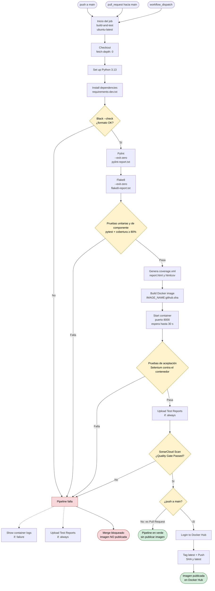
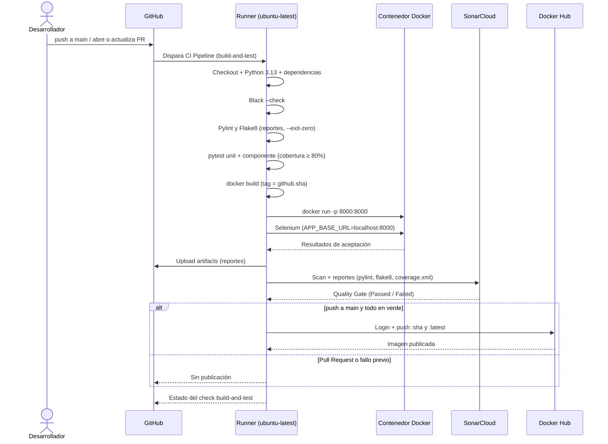

# Pipeline de CI – Entregable 2

Diagrama del workflow `.github/workflows/ci.yml` (job `build-and-test`).

## Vista general

## Secuencia de ejecución

## Política de fallos

| Paso | ¿Detiene el pipeline? | Se ejecuta en |
|---|---|---|
| Black (`--check`) | Sí | push y PR |
| Pylint y Flake8 | No por hallazgos (`--exit-zero`) | push y PR |
| Pruebas unitarias y de componente (≥ 80%) | Sí | push y PR |
| Build y arranque del contenedor | Sí | push y PR |
| Pruebas de aceptación (Selenium) | Sí | push y PR |
| SonarCloud Quality Gate | Sí | push y PR |
| Login y push a Docker Hub | — | Solo push a `main` |
| Show container logs | — | Solo si hay fallo (`failure()`) |
| Upload Test Reports | — | Siempre (`always()`) |
