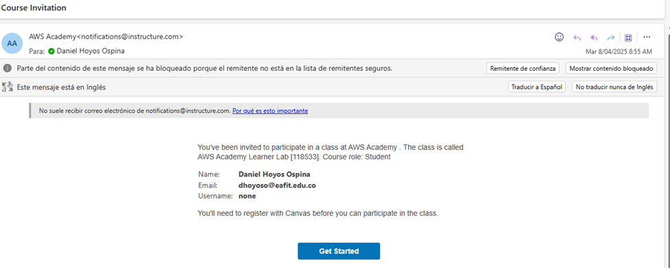
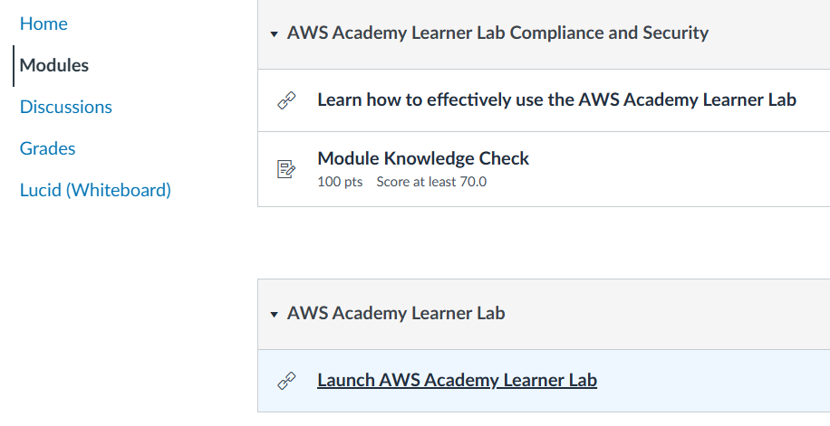
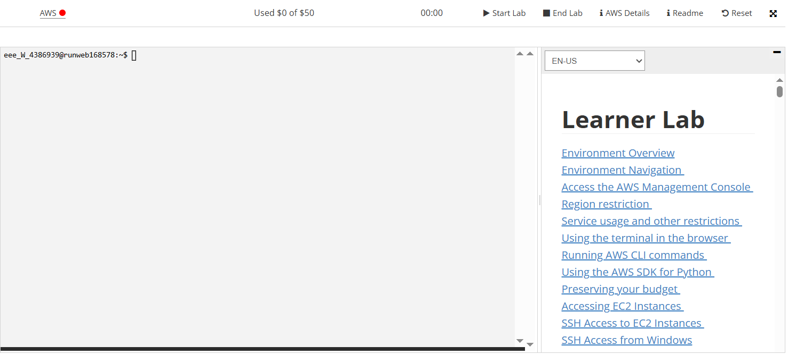
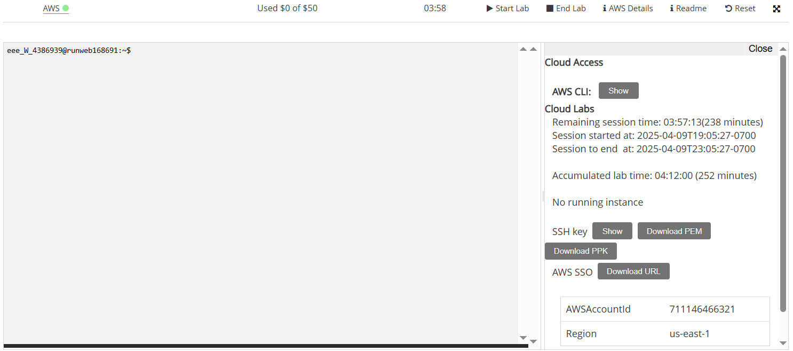

# Taller Entregable 3: Despliegue Continuo (CD) con AWS ECS e Infraestructura como Código

Este taller es una continuación del Taller 2, donde construimos un pipeline de Integración Continua (CI) que genera una imagen Docker de nuestra aplicación. Ahora, nos enfocaremos en la **Entrega Continua (Continuous Delivery)** y el **Despliegue Continuo (Continuous Deployment)**, automatizando el despliegue de esa imagen Docker a **AWS Elastic Container Service (ECS)**, primero a un entorno de **Staging** y luego a **Producción**, utilizando **Infraestructura como Código (IaC)** con **Terraform**.

Te invito a que investigues un poco sobre estos servicios y conceptos antes de comenzar, ya que son fundamentales para el desarrollo moderno de software y la entrega continua.

Aquí algunos links útiles para ello:
* [AWS ECS](https://aws.amazon.com/ecs/)
* [Terraform](https://developer.hashicorp.com/terraform/docs)
* [Terraform AWS Provider](https://registry.terraform.io/providers/hashicorp/aws/latest/docs)

## Conceptos Previos
* **AWS CLI**: Interfaz de línea de comandos para interactuar con AWS. Permite gestionar recursos y servicios de AWS desde la terminal.
* **Terraform**: Herramienta de Infraestructura como Código (IaC) de HashiCorp que permite crear, modificar y eliminar recursos en múltiples proveedores cloud (AWS, Azure, GCP, etc.) mediante archivos de configuración declarativos escritos en HCL (HashiCorp Configuration Language).
* **Docker**: Plataforma para desarrollar, enviar y ejecutar aplicaciones en contenedores. Permite empaquetar aplicaciones y sus dependencias en un solo contenedor, asegurando que funcionen de manera consistente en diferentes entornos.

## Pre requisitos y modalidad de trabajo
* **Equipos de 3 integrantes, exactamente los mismos del Taller 2**, y cada equipo entrega **un único repositorio público**. Los equipos **no pueden cambiar**: el grupo que creó el profesor en EAFIT Interactiva para el Taller 2 es el mismo que se usa en este taller y en el proyecto final, así que no hace falta volver a registrarlo. Igual que en el Taller 2:
    * **Secciones 7.1 a 7.9: cada integrante trabaja en su propio repositorio**, con sus propias cuentas de GitHub, Docker Hub, SonarCloud y **AWS Academy**. Así todos practican cada paso, y si a alguien algo no le funciona, el equipo puede continuar con otro repositorio. Cada uno parte de su repositorio del Taller 2; si el suyo no quedó funcionando, puede partir del repositorio que el equipo entregó en el Taller 2 (sección 7.1).
    * **Sección 7.10 en adelante: el equipo elige un solo repositorio** (uno que cumpla el punto de control de la sección 7.9). Su dueño pasa a ser el **propietario**, y los otros dos integrantes se agregan como **colaboradores** (Pull Requests, revisiones y aprobaciones). **Ese es el único repositorio que se entrega y se califica**; los demás sirven para aprender y como respaldo, y no se revisan.
    * **En todos los repositorios**, `AUTOR` y la sección **Integrantes** del README tienen los nombres de los 3 integrantes, para que no importe cuál se entregue.
    * Las credenciales de AWS son personales y **nunca se comparten**, ni siquiera dentro del equipo.
* Haber finalizado el Taller 2 y tener los artefactos desarrollados en ese taller (app, Dockerfile, pruebas, `requirements.txt` y `requirements-dev.txt`, pipeline de CI, regla de protección de `main`, etc.). En la sección 7.1 crearás un repositorio nuevo a partir de una copia del Taller 2, que quedará intacto.
* Instalar AWS CLI. Puedes seguir la guía oficial [aquí](https://docs.aws.amazon.com/cli/latest/userguide/getting-started-install.html).
* Instalar Terraform. Puedes seguir la guía oficial [aquí](https://developer.hashicorp.com/terraform/install). Verifica la instalación ejecutando `terraform --version` (debe retornar versión ≥ 1.10.0; recomendamos la 1.17, la misma que usará el pipeline).
* Instalar Docker. Puedes seguir la guía oficial [aquí](https://docs.docker.com/get-docker/). Puedes omitir este paso si ya tienes Docker instalado y funcionando en tu máquina. Asegúrate de que Docker esté corriendo y que puedas ejecutar comandos de Docker desde la terminal. Puedes verificarlo ejecutando `docker --version`.
* Tener acceso a una cuenta de AWS:
  * Para este curso, les debió haber llegado en la(s) ultima(s) semanas un correo electrónico con asunto "Course Invitation" de AWS Academy. 
  
  * Lo abren, hacen click en el botón "Get Started" y siguen las instrucciones para crear su cuenta de Canvas y AWS Academy.
  * Una vez tienen su cuenta creada, pueden ingresar usando el siguiente [link](https://www.awsacademy.com/vforcesite/LMS_Login), en el botón "Student Login" con su correo y contraseña.
  * Una vez ingresan, van a estar en el dashboard y deben hacer click en el curso llamado "AWS Academy Learning Lab".
  * Una vez dentro del curso, van a la sección "Modules" o "Modulos" y buscan el apartado "AWS Academy Learning Lab" y dan click en "Launch AWS Academy Learning Lab" o "Iniciar el Laboratorio de aprendizaje de AWS Academy".
  
  * Bajan hasta el final y aceptan los términos y condiciones "I agree".
  * Luego, les debe aparecer una consola como esta, allí deben dar click en "Start Lab" (aparecerá un icono de carga que puede tomar varios minutos). Esto les va a habilitar una cuenta de AWS con un presupuesto de $50 USD para que puedan hacer los ejercicios de este taller. Cada vez que dan "Start Lab" se inicia una sesión que dura 4 horas, al finalizarse la sesión se suspende la cuenta y su uso.
  
  * Una vez el botón al lado de AWS (que estaba en rojo y durante el encendido estaba en amarillo) se pone en verde, pueden dar click en "AWS Details" para ver los detalles de su cuenta de AWS. Allí pueden dar click en `AWS CLI: Show` para ver sus credenciales de acceso programático (Access Key ID, Secret Access Key y Session Token) que necesitarán para configurar el AWS CLI. **¡Nunca compartas tus credenciales ni las subas a GitHub directamente!**. En la parte de abajo también pueden ver el ID y región de su cuenta de AWS, que es importante para la configuración del pipeline de GitHub Actions.
  
  * Si dan click al botón de "AWS" en la parte superior, se abrirá una consola de AWS en una nueva pestaña. Allí pueden ver todos los servicios de AWS disponibles para su cuenta. **Recuerden que esta cuenta tiene un presupuesto limitado de $50 USD, así que deben tener cuidado con los recursos que crean y eliminarlos cuando terminen de usarlos.** En el taller no será necesario crear recursos manualmente (salvo el bucket S3 del estado de Terraform, que crearás con un comando de la AWS CLI), ya que todo se hará a través de Terraform y el pipeline de GitHub Actions. Sin embargo, si necesitan crear recursos manualmente o validar la creación de los recursos y la salud de los mismos, pueden hacerlo desde esta consola.
  * **¡MUY IMPORTANTE!**: Recuerden que esta cuenta de AWS es temporal y solo está disponible durante la duración del curso. No deben usarla para proyectos personales o producción. Al finalizar el curso, su cuenta será desactivada y perderán acceso a todos los recursos creados.

  *  **Características clave de la sesión y la cuenta de AWS:**

        1.  **Persistente:** Aunque tu sesión termine cuando el contador llegue a 0:00, todos los datos y recursos que hayas creado se guardarán. Al iniciar una nueva sesión (incluso otro día), encontrarás tu trabajo anterior.
        2.  **Estado de los Recursos al Terminar/Iniciar Sesión:**
            * **Instancias EC2:** Se detendrán al finalizar la sesión y se reiniciarán automáticamente la próxima vez que inicies una.
            * **Instancias de Notebook SageMaker:** Se detendrán, pero *no* se reiniciarán automáticamente en la siguiente sesión.
            * **Aplicaciones SageMaker Canvas:** Permanecerán activas a menos que las elimines manualmente.
        3.  **¡MUY IMPORTANTE: Presupuesto!**
            * Debes monitorear constantemente tu presupuesto restante en la interfaz del laboratorio.
            * Esta información del presupuesto se actualiza cada 8 a 12 horas, por lo que puede no reflejar tu gasto más reciente inmediatamente.
            * **Si excedes tu presupuesto, tu cuenta será desactivada y perderás TODO tu progreso y recursos.** Es fundamental que administres tus gastos para evitarlo.
            * Monitoriza tu gasto en la interfaz de Learner Lab. Usa los recursos mínimos sugeridos y considera **destruir la infraestructura con `terraform destroy`** después de validar el taller para ahorrar presupuesto.
            * **¿Cuánto cuesta este taller?** Cada ambiente (Staging o Producción) consume aproximadamente **USD 0,05 por hora** (Load Balancer, IPs públicas y una tarea Fargate pequeña), es decir, cerca de **USD 1,2 por día**; con los dos ambientes, unos **USD 2,4 por día**. Desarrollar el taller en pocos días cuesta solo unos dólares, pero si dejas todo encendido varias semanas consumirás el presupuesto completo. **Los Load Balancers y las tareas Fargate siguen generando costo aunque cierres la sesión del laboratorio**: el único modo de detener el gasto es destruirlos (sección 10).
        4. **Región:**
            * **SOLO** puedes usar las regiones `us-east-1` (N. Virginia) o `us-west-2` (Oregón) para todos tus recursos (CLI, secretos). Cualquier intento de usar otra región fallará.
            * **La región que utilizaremos en este taller es `us-east-1` (N. Virginia)**. Asegúrate de que tu configuración local (AWS CLI) y el pipeline de GitHub Actions estén configurados para esta región (ver sección 5.1).
        5. **Rol IAM `LabRole`:** No puedes crear roles IAM libremente. Debes usar el rol pre-creado `LabRole` donde sea necesario (especialmente en la configuración de tareas ECS). Los archivos de Terraform ya lo tienen en cuenta: lo buscan automáticamente por su nombre. Este rol tiene permisos limitados y no puedes modificarlo.


## 1. Conceptos de Entrega Continua y Despliegue Continuo (CD)

* **Entrega Continua (Continuous Delivery):** Práctica donde los cambios de código (empaquetados como artefactos, en nuestro caso, una imagen Docker) se construyen, prueban y preparan *automáticamente* para producción. La imagen se despliega automáticamente a un entorno de **Staging** (o pre-producción). La *liberación* a **Producción** requiere una **aprobación manual** o un trigger deliberado. El objetivo es tener *siempre* una versión validada lista para ir a producción rápidamente.
* **Despliegue Continuo (Continuous Deployment):** Va un paso más allá. *Cada cambio* (cada nueva imagen Docker) que pasa *todas* las etapas automatizadas (incluyendo pruebas en Staging) se despliega **automáticamente a Producción** sin intervención humana. Requiere una confianza extrema en la automatización y las pruebas.

**En este taller implementarás los dos enfoques:** primero construirás un pipeline de **Despliegue Continuo** completo y, al final (sección 7.11), agregarás una **aprobación manual** antes de Producción para convertirlo en **Entrega Continua**, que es el enfoque más común en las empresas.

**Flujo de trabajo General:**

1.  **CI (Integración Continua):** Código -> Pruebas (Unitarias y de Componente) -> Build Imagen Docker -> Pruebas de Aceptación sobre el contenedor -> Análisis (SonarCloud) -> **Imagen Docker (Artefacto)** -> Push a Docker Hub. (Cubierto en el Taller 2).
2.  **CD (Este Taller - Staging y Producción con Terraform):** Imagen Docker -> **Deploy Staging (Terraform - Auto)** -> **Pruebas de Aceptación en Staging (Auto)** -> **Aprobación manual** -> **Deploy Producción (Terraform)** -> **Pruebas de Humo en Producción (Auto)** -> Monitoreo y Rollback automático (ECS).

## 2. Diferencias entre Continuous Deployment y Continuous Delivery

| Característica         | Continuous Delivery                      | Continuous Deployment                         |
| :--------------------- | :--------------------------------------- | :-------------------------------------------- |
| **Despliegue a Prod.** | Manual (requiere aprobación)             | Automático (sin intervención manual)          |
| **Frecuencia Despl.** | Controlada (puede ser frecuente)         | Muy frecuente (cada imagen validada)          |
| **Confianza Automat.** | Alta                                     | **Extrema** (requiere pruebas/monitoreo robustos) |
| **Velocidad (Lead Time)**| Más lento                                | Más rápido                                    |
| **Intervención Humana**| Sí (para liberar a Prod)                 | No (idealmente)                               |
| **Feedback Producción**| Retrasado por aprobación                   | Muy rápido (directamente de producción)       |

La elección depende del contexto. En este taller usaremos AWS ECS y Terraform con un entorno de Staging: primero desplegaremos automáticamente a Producción una vez validadas las pruebas en Staging (Despliegue Continuo) y, al final, agregaremos la aprobación manual antes de Producción (Entrega Continua).

## 3. Introducción a AWS y ECS

Para este taller, utilizaremos **Amazon Web Services (AWS)**, el proveedor líder de servicios en la nube. Específicamente, usaremos **Elastic Container Service (ECS)** para orquestar y ejecutar nuestros contenedores Docker. ECS es un servicio altamente escalable y de alto rendimiento que facilita la ejecución de aplicaciones en contenedores en AWS similar a Docker Swarm o Kubernetes.

**¿Por qué AWS ECS para este taller?**

* Es un servicio de orquestación de contenedores potente y ampliamente utilizado en la industria.
* Se integra nativamente con otros servicios de AWS (VPC, Load Balancing, IAM, CloudWatch).
* Ofrece opciones flexibles de cómputo (EC2 y Fargate). Usaremos **Fargate** para simplificar la gestión.
* El presupuesto de AWS Academy cubre los costos de este ejercicio si se usan recursos mínimos (tareas Fargate pequeñas) y se destruyen al terminar.
* Nos permite implementar **Infraestructura como Código** usando Terraform.

## 4. CI/CD en Arquitecturas Modernas

### 4.1 Contenedores (Docker)

Los contenedores Docker son la base de nuestro despliegue. Como vimos en el Taller 2, empaquetan nuestra aplicación Flask y sus dependencias. Son consistentes, portátiles y permiten despliegues rápidos. La imagen generada en CI se subirá a Docker Hub y AWS ECS la descargará para ejecutarla.

**Ventajas clave para CD:**

* **Inmutabilidad:** Una vez construida, la imagen no cambia. Desplegamos la *misma* imagen en Staging y Producción, garantizando consistencia.
* **Portabilidad:** La imagen creada localmente o en CI se puede ejecutar en AWS ECS sin modificaciones.
* **Despliegue rápido:** Iniciar un contenedor es mucho más rápido que aprovisionar una VM.

**Docker en nuestro CI/CD con AWS:**

1.  **Dockerfile:** Definido en Taller 2.
2.  **Construcción y Push:** Realizado en el pipeline de CI (Taller 2), la imagen se almacena en Docker Hub.
3.  **Registro:** Usamos Docker Hub como nuestro registro de imágenes. AWS ECS descargará la imagen desde allí.
4.  **Despliegue en ECS:** El pipeline de CD, mediante Terraform, le indicará a AWS ECS que descargue una versión específica de la imagen (identificada por su tag: el SHA del commit) y la ejecute como un servicio.

### 4.2 Kubernetes (Alternativa a ECS)

Kubernetes (K8s) es otro potente orquestador de contenedores. Aunque no lo usaremos en este taller, es importante conocerlo como una alternativa a ECS, especialmente para escenarios multicloud o de mayor complejidad. AWS ofrece un servicio gestionado de Kubernetes llamado EKS (Elastic Kubernetes Service). Los conceptos de Pods, Services, Deployments son similares a los Task Definitions, Services y Load Balancers en ECS.

### 4.3 Serverless (Alternativa a Contenedores para ciertos casos)

Serverless, como AWS Lambda, es excelente para código basado en eventos o APIs simples. Para una aplicación web como la nuestra, que necesita estar ejecutándose constantemente para recibir peticiones HTTP, ECS (o K8s) suele ser más adecuado que una arquitectura puramente basada en funciones Lambda + API Gateway, aunque existen patrones híbridos.

## 5. AWS CLI (Command Line Interface)

La AWS CLI es una herramienta unificada para administrar tus servicios de AWS desde la línea de comandos. Es esencial para automatizar tareas e interactuar con AWS desde scripts o pipelines de CI/CD.

```bash
# Verifica la instalación de AWS CLI que realizaste en la sección de prerequisitos
aws --version
```

### 5.1 Configuración Local

Una vez instalado, necesitas configurar la CLI con tus credenciales de AWS. Desde AWS Academy copia todo el archivo de credenciales (Access Key ID, Secret Access Key y Session Token) tal y como se muestra en la consola de AWS Academy incluyendo el perfil `[default]`. 

Luego, busca el archivo de credenciales en tu máquina local (usualmente `~/.aws/credentials` en Linux/Mac o `C:\Users\<tu_usuario>\.aws\credentials` en Windows) y pega el contenido del archivo de credenciales que copiaste de AWS Academy.

Luego corre el comando `aws configure` en la terminal para configurar la CLI. Este comando te pedirá que ingreses tus credenciales de AWS (simplemente presiona Enter si ya las copiaste en el archivo de credenciales). Luego, te pedirá que ingreses la región y el formato de salida. Puedes dejar el formato de salida en blanco o elegir `json` y la región `us-east-1` (N. Virginia) como se mencionó anteriormente.

Finalmente, puedes probar si la configuración funciona correctamente ejecutando un comando simple como:
```bash
aws sts get-caller-identity
```

Te debe retornar información sobre tu identidad de AWS, algo similar a:
```json
{
    "UserId": "AROAEXAMPLE:user1234567=Tu_Nombre",
    "Account": "123456789012",
    "Arn": "arn:aws:sts::123456789012:assumed-role/voclabs/user1234567=Tu_Nombre"
}
```
Esto indica que la CLI está configurada correctamente y puede interactuar con tu cuenta de AWS. El ARN muestra `assumed-role/voclabs` porque en el Learner Lab trabajas con un rol temporal y no con un usuario IAM permanente. Por eso las credenciales cambian en cada sesión (sección 5.2).

> **Cada vez que inicies una nueva sesión del laboratorio** debes volver a copiar las credenciales en el archivo `credentials`: las anteriores dejan de funcionar.

### 5.2 Uso en el Pipeline

En el pipeline de GitHub Actions no usaremos `aws configure`. En su lugar, la acción `aws-actions/configure-aws-credentials` toma las credenciales desde los secretos de GitHub y las deja disponibles para los pasos siguientes del job, donde se ejecutan los comandos de Terraform (`terraform init`, `terraform apply`, `terraform output`).

**Las credenciales de AWS Academy son temporales:** duran lo mismo que la sesión del laboratorio (máximo 4 horas) y cambian cada vez que haces **Start Lab**. Cuando expiran, los jobs que usan AWS fallan con mensajes como `ExpiredToken` o `The security token included in the request is invalid`. No es un error de tu código: solo debes renovarlas.

**Lista de chequeo para renovar las credenciales** (la realiza cada integrante, con sus propias credenciales, cada vez que inicia una nueva sesión del laboratorio y va a desplegar):

1. En AWS Academy haz clic en **Start Lab** y espera a que el indicador junto a "AWS" esté en verde.
2. Abre **AWS Details → AWS CLI: Show** y copia los 3 valores.
3. **Local:** reemplaza el contenido de tu archivo `credentials` (ver 5.1) y verifica con `aws sts get-caller-identity`.
4. **GitHub:** en **Settings → Secrets and variables → Actions**, edita (ícono de lápiz) los secretos `AWS_ACCESS_KEY_ID`, `AWS_SECRET_ACCESS_KEY` y `AWS_SESSION_TOKEN`. Actualiza siempre los 3: funcionan como un juego y no sirven mezclados con los de otra sesión.
5. Si una ejecución había fallado por credenciales expiradas, ábrela en la pestaña **Actions** y usa **Re-run jobs → Re-run failed jobs**. No necesitas hacer un commit nuevo.

> **Informativo — ¿Cómo se hace en una empresa?** En un entorno real no se guardan llaves de AWS en los secretos de GitHub. Se usa **OIDC (OpenID Connect)**: AWS confía en GitHub Actions mediante un rol IAM, y en cada ejecución el pipeline recibe credenciales temporales que expiran solas, sin que nadie tenga que copiarlas. No lo usaremos porque el Learner Lab no permite crear roles IAM ni proveedores de identidad. **No debes configurar nada de esto.**

## 6. Infraestructura como Código (IaC) con Terraform

**Infraestructura como Código (IaC)** es la práctica de gestionar infraestructura mediante código. Terraform es la herramienta de IaC open source de HashiCorp que permite modelar y aprovisionar recursos en múltiples proveedores cloud de forma segura y repetible usando archivos de configuración declarativos.

**Ventajas de Terraform:**

* **Declarativo:** Defines el estado deseado, Terraform se encarga de alcanzarlo.
* **Multi-cloud:** El mismo lenguaje (HCL) funciona con AWS, Azure, GCP y más de 1.000 proveedores.
* **Automatización y Consistencia:** Despliegues rápidos, repetibles y consistentes entre entornos.
* **Versionado:** Los archivos `.tf` se pueden versionar en Git.
* **Plan antes de aplicar:** `terraform plan` (y el resumen que muestra `terraform apply` antes de pedir confirmación) indica exactamente qué va a cambiar *antes* de hacerlo, reduciendo el riesgo de cambios inesperados.
* **Gestión de Estado:** Mantiene el estado de la infraestructura y permite actualizaciones y eliminaciones controladas.

**Archivos de configuración de Terraform:**

* Son archivos de texto con extensión **`.tf`** escritos en HCL (HashiCorp Configuration Language).
* **Estructura Principal:**
    * `terraform {}`: Bloque de configuración del backend (dónde se guarda el estado) y de los proveedores requeridos.
    * `provider "aws" {}`: Configuración del proveedor de AWS (región, etiquetas comunes).
    * `variable {}`: Valores de entrada para parametrizar la configuración (ej: nombre del ambiente, URI de la imagen).
    * `data {}`: Consulta recursos que **ya existen** en la cuenta, sin crearlos ni modificarlos (ej: el rol `LabRole` o la VPC por defecto).
    * `resource {}`: La definición de los recursos AWS a crear (ECS Cluster, Service, ALB, etc.). **Esta es la sección principal.**
    * `output {}`: Valores que se exponen después de aplicar la configuración (ej: URL del ALB).
* **Archivos que crearemos en la carpeta `infra/`:**
    * `variables.tf`: Declara los parámetros de entrada.
    * `main.tf`: Define los recursos AWS y consulta los existentes.
    * `outputs.tf`: Expone los valores de salida (URL del ALB, nombres del cluster y servicio).
    * `backend.hcl`: Indica en qué bucket S3 se guarda el estado.

**Consideraciones para Learner Lab:**

* **Rol `LabRole`:** Terraform ejecuta las acciones con tus credenciales del Learner Lab, que no tienen permiso para crear roles IAM. Por eso **no creamos roles** (`aws_iam_role`): consultamos el `LabRole` existente con un `data source` que lo busca por su nombre. No necesitas copiar su ARN en ninguna parte.
* **VPC por defecto:** Para evitar problemas de permisos al crear redes, usamos la **VPC por defecto** de la cuenta y sus **subredes por defecto** en las zonas `us-east-1a` y `us-east-1b`. Estas subredes son públicas (tienen salida a Internet), lo que permite a las tareas descargar la imagen de Docker Hub. Usamos dos zonas porque el Load Balancer exige al menos dos, y limitamos a estas porque no todas las zonas de `us-east-1` soportan Fargate. Terraform las encuentra con `data sources`, así que tampoco necesitas copiar sus IDs.
* **Estado de Terraform:** Terraform guarda en un archivo de **estado** qué recursos creó y sus identificadores. Así, en el siguiente `apply` sabe que el ALB ya existe y lo actualiza en lugar de intentar crearlo de nuevo. En este taller **despliegas desde dos lugares**: primero desde tu computador y luego desde el pipeline, que se ejecuta cada vez en una máquina nueva. Si el estado quedara en tu computador, el pipeline no sabría que la infraestructura existe e intentaría crearla otra vez, fallando con errores `already exists`. Por eso guardamos el estado en un **bucket S3 (backend remoto)** que comparten tu computador y el pipeline:
    * `use_lockfile = true` activa el **bloqueo del estado**: mientras un `apply` se ejecuta, Terraform crea un archivo `.tflock` en el bucket y nadie más puede modificar la infraestructura al mismo tiempo.
    * El **versionado** del bucket guarda las versiones anteriores del estado, por si alguna vez se daña.
    * El archivo de estado **nunca debe subirse a Git**: contiene detalles de tu infraestructura.
* **Workspaces (Staging y Production):** Usamos los mismos archivos `.tf` para los dos ambientes. Si ambos compartieran un único estado, el `apply` de producción "reemplazaría" a staging. Los **Terraform Workspaces** dan a cada ambiente su propio estado dentro del mismo bucket (`env:/staging/...` y `env:/production/...`). Se usan **igual en local y en el pipeline** con el comando `terraform workspace select -or-create <ambiente>`, que selecciona el workspace o lo crea si aún no existe.

## 7. Implementación del Pipeline CD con Staging y Producción en AWS ECS usando Terraform

**Roles en esta sección:** las secciones 7.1 a 7.9 las realiza **cada integrante en su propio repositorio**, con sus cuentas de GitHub, Docker Hub, SonarCloud y AWS Academy (pueden apoyarse entre ustedes, por ejemplo en una llamada compartiendo pantalla). **Las credenciales de AWS nunca se comparten**, ni siquiera dentro del equipo. Al inicio de la sección 7.10 el equipo elige el repositorio que entregará: las secciones 7.10 y 7.11 las realiza su **propietario**, y la sección 7.12 los **colaboradores**.

### 7.1 Crea el repositorio del Taller 3 a partir del Taller 2

Como el Taller 2 se califica por separado, **no se modifica**: el Taller 3 se trabaja en un repositorio nuevo que parte de una copia del Taller 2. Las cuentas de Docker Hub, SonarCloud y AWS son las mismas, por eso en esta sección y la siguiente cambiaremos los nombres que podrían cruzarse con el Taller 2.

1. En GitHub crea un repositorio **público** y **vacío** llamado `cicd-pipeline-python-cd`. **No** agregues README, `.gitignore` ni licencia: si el repositorio no está vacío, el primer push será rechazado. Usa solo minúsculas: el nombre de la imagen Docker se forma con el nombre del repositorio y Docker Hub no acepta mayúsculas.

2. Clona el repositorio del Taller 2 en una carpeta nueva y cambia su destino (`origin`) a **tu** repositorio nuevo. Puedes partir de **tu propio** repositorio del Taller 2 o, si el tuyo no quedó funcionando, del repositorio que el equipo **entregó** en el Taller 2 (este último incluye además las pruebas del Pull Request de la sección 9):

    ```bash
    git clone https://github.com/USUARIO_TALLER2/cicd-pipeline-python.git cicd-pipeline-python-cd
    cd cicd-pipeline-python-cd
    git remote set-url origin https://github.com/TU_USUARIO/cicd-pipeline-python-cd.git
    git remote -v
    ```

    > **⚠️ Verifica la salida de `git remote -v` antes de continuar:** las dos líneas deben terminar en `cicd-pipeline-python-cd.git`. Si siguen apuntando a `cicd-pipeline-python.git`, el siguiente push modificaría la entrega del Taller 2. Reemplaza `USUARIO_TALLER2` por el usuario de GitHub dueño del repositorio del Taller 2 que vas a copiar, y `TU_USUARIO` por el tuyo.

    ```bash
    git push -u origin main
    ```

    > **Es normal que esta primera ejecución del pipeline falle** en la pestaña **Actions**: el repositorio nuevo aún no tiene secretos, variables ni proyecto de SonarCloud. Los configurarás en la sección 7.2.

3. **Crea el entorno virtual e instala las dependencias** (la carpeta `venv/` no se copia porque está en el `.gitignore`):

    ```bash
    python -m venv venv
    venv\Scripts\activate     # En Windows
    source venv/bin/activate  # En Linux/macOS
    pip install -r requirements-dev.txt
    ```

    > **Recuerda la separación de dependencias del Taller 2:** `requirements.txt` contiene solo lo que la aplicación necesita para ejecutarse (Flask y Gunicorn) y es lo único que se instala dentro de la imagen Docker. `requirements-dev.txt` incluye `requirements.txt` más las herramientas de pruebas y análisis. **En tu computador y en todos los jobs del pipeline se instala `requirements-dev.txt`**. En este taller **no se agregan dependencias nuevas**: Terraform no es un paquete de Python, y las pruebas de humo que crearás usan solo la biblioteca estándar.

**¿Qué se copia al clonar y qué debes volver a configurar?**

| Elemento | ¿Se copia al clonar? | Qué hacer |
|---|---|---|
| Código, pruebas, `Dockerfile`, workflow, archivos de configuración | Sí | Ajustar `sonar.projectKey` (7.2) |
| Historial de commits | Sí | Nada |
| Secretos y variables de GitHub Actions | **No** | Crearlos de nuevo (7.2 y 7.8) |
| Colaboradores | **No** | Se agregan solo en el repositorio que elija el equipo (7.10) |
| Regla de protección `proteger-main` | **No** | Crearla de nuevo (7.10) |
| Proyecto de SonarCloud | **No** | Crear uno nuevo (7.2) |
| Repositorio de la imagen en Docker Hub | **No** | Se crea solo con el primer push de la imagen: `usuariodockerhub/cicd-pipeline-python-cd` |
| Entorno virtual `venv/` | **No** | Crearlo (paso 3) |

### 7.2 Configura SonarCloud, secretos y variables del repositorio nuevo

1. **Crea el proyecto en SonarCloud:** **My Projects → Analyze a new project**, selecciona `cicd-pipeline-python-cd`, haz clic en **Set Up** y finaliza el proceso igual que en el Taller 2.
    > Si el repositorio no aparece en la lista, la aplicación de SonarCloud en GitHub tiene acceso solo a algunos repositorios. En GitHub ve a la configuración de tu cuenta **Settings → Applications → Installed GitHub Apps → SonarQube Cloud → Configure**, agrega `cicd-pipeline-python-cd` y vuelve a SonarCloud.

2. Igual que en el Taller 2: desactiva el **Automatic Analysis** (**Administration → Analysis Method**), haz el proyecto **público** (**Administration → Permissions** dentro de tu proyecto en SonarCloud y, en **Project visibility**, selecciona **"Public - Anyone"**) y configura el código nuevo en **Administration → New code → "Number of days" = 30** (Taller 2, sección 5.2, paso 3). Sin este ajuste, el Quality Gate no evaluaría el código que traes del Taller 2. Agrega también la exclusión del README y los workflows en **Administration → General Settings → Analysis Scope → Source File Exclusions**: `README.md,**/*.md,docs/**,.github/**` (Taller 2, sección 5.2, paso 3). Así aplica siempre, incluso si el Automatic Analysis quedara activo por accidente.

3. **Actualiza `sonar-project.properties`:** cambia la clave del proyecto por la del proyecto nuevo (puedes copiarla exacta desde **Information** en SonarCloud). La organización (`sonar.organization`) no cambia. Verifica que el archivo conserve la línea `sonar.exclusions=README.md,**/*.md,docs/**,.github/**` del Taller 2: el README, la documentación y los workflows no deben generar hallazgos.

    ```properties
    sonar.projectKey=[TU_USUARIO]_cicd-pipeline-python-cd
    ```

    > **⚠️ Si dejas la clave anterior**, el análisis de este repositorio se enviaría al proyecto del Taller 2 y cambiaría su resultado afectando su calificación. Lo que vas a cambiar si estás usando el mismo usuario de GitHub es solo el nombre del proyecto (usualmente derivado del nombre del repositorio).

4. **Crea los secretos y variables:** los valores de los secretos de GitHub no se pueden leer ni copiar a otro repositorio, así que genera tokens nuevos como en el Taller 2 (sección 5.2, pasos 4 y 5): un token de SonarCloud y un token de Docker Hub. Luego, en **Settings → Secrets and variables → Actions** del repositorio nuevo crea:
    * **Secretos:** `SONAR_TOKEN` y `DOCKERHUB_TOKEN`.
    * **Variables:** `DOCKERHUB_USERNAME` (tu Docker ID) y `SONAR_HOST_URL` (`https://sonarcloud.io`).

    Los nombres deben escribirse exactamente así (mayúsculas incluidas): el workflow los busca por su nombre. Los secretos de AWS los crearás en la sección 7.8.

5. **Prepara el `README.md`:** conserva la sección **Integrantes** y elimina las evidencias y respuestas del Taller 2; las del Taller 3 las agregarás en la sección 9. La variable `AUTOR` de `app/calculadora.py` no cambia, porque el equipo es el mismo del Taller 2.

### 7.3 Agrega el endpoint `/health` y publica la nueva imagen

El Load Balancer (ALB) de AWS necesita una ruta para verificar periódicamente que la aplicación está viva: el **health check**. Crearemos la ruta `/health`, que responde un JSON con el estado y la **versión desplegada**. La versión la leerá de la variable de entorno `APP_VERSION`: en AWS, Terraform le pondrá el SHA del commit; en tu computador, como la variable no existe, responderá `"local"`. Gracias a esto, el pipeline podrá comprobar que en cada ambiente está corriendo exactamente la versión que acaba de desplegar.

1. **Modifica `app/app.py`:** agrega `import os` al inicio del archivo (antes de los imports de Flask) y la nueva ruta antes del bloque `if __name__ == "__main__":`

    ```python
    import os

    from flask import Flask, render_template, request
    # ... resto del archivo sin cambios ...


    @app.route("/health")
    def health():
        """Health check usado por el Load Balancer. Incluye la versión desplegada."""
        return {"status": "ok", "version": os.environ.get("APP_VERSION", "local")}
    ```

    > Flask convierte automáticamente el diccionario en una respuesta JSON con código 200.

2. **Agrega una prueba de componente en `tests/test_app.py`:**

    ```python
    def test_health(client):
        response = client.get("/health")
        assert response.status_code == 200
        assert response.get_json() == {"status": "ok", "version": "local"}
    ```

3. **Verifica localmente** con los mismos comandos del Taller 2:

    ```bash
    black app --check
    pytest --ignore=tests/test_acceptance_app.py --cov-fail-under=80
    ```

    Todas las pruebas deben pasar, incluida `test_health`. Si quieres verlo en el navegador, ejecuta `python -m app.app` y abre `http://localhost:5000/health`.

4. **Sube los cambios** (aún puedes hacer push directo a `main`; la protección se crea en la sección 7.10):

    ```bash
    git add .
    git commit -m "Agregar endpoint /health y configurar SonarCloud del Taller 3"
    git push origin main
    ```

5. **Revisa el resultado de SonarCloud en el proyecto nuevo:** **el paso `SonarCloud Scan` puede fallar en esta primera ejecución**, aunque el código no tenga ningún issue. En el primer análisis de un proyecto, SonarCloud puede no calcular el Quality Gate (queda como *Not computed*), y el scanner lo reporta igual como fallido.

    **¿Cómo sabes si falló por eso o porque el código no cumple?**

    * En el log del paso `SonarCloud Scan`, en ambos casos verás al final `QUALITY GATE STATUS: FAILED` y `EXECUTION FAILURE`. Abre el enlace `View details on https://sonarcloud.io/dashboard?id=...` que aparece en esa misma línea.
    * En SonarCloud (**Analysis → Summary** del proyecto), mira el recuadro **Quality gate**:
        * **Not computed:** no es un error de tu código; es el primer análisis. Continúa con la revisión de issues y vuelve a ejecutar.
        * **Failed:** el gate sí se calculó y el código no cumple. SonarCloud muestra las condiciones que fallaron (por ejemplo, *Security rating*, cobertura o duplicación); corrígelas antes de volver a ejecutar.

    **Antes de volver a ejecutar, revisa los issues:** abre **Issues** en el proyecto nuevo. Los cambios de estado y los comentarios no se copian entre proyectos, así que:

    * Los issues que **corregiste en el código** en el Taller 2 no vuelven a aparecer, porque el código ya viene corregido. Si los corregiste todos, verás 0 issues.
    * Los issues que **aceptaste** en el Taller 2 (por ejemplo, el de protección CSRF, *"Make sure disabling CSRF protection is safe here"*) aparecen otra vez abiertos. Acéptalos de nuevo con la misma justificación (Taller 2, sección 8, paso 5): selecciónalo, pulsa **Change**, en **Change status** elige **Accept** y escribe el comentario.
    * Si aparece un issue que no estaba en el Taller 2 (por ejemplo, porque SonarCloud actualizó sus reglas), corrígelo en el código como en el Taller 2. Solo acéptalo, con justificación, si es válido pero no aplica corregirlo en este contexto.
    * Luego, en GitHub abre la ejecución fallida y usa **Re-run jobs → Re-run failed jobs**. En este segundo análisis el Quality Gate ya se calcula, y debe quedar en `Passed` (en el log verás `QUALITY GATE STATUS: PASSED`). Ten en cuenta que el Quality Gate se recalcula en cada análisis, no al cambiar el estado de un issue: por eso hay que volver a ejecutar.

    > La página **Security hotspots** de SonarCloud está deprecada: los antiguos hotspots ahora aparecen como issues de seguridad en **Issues**. No necesitas revisarla.

6. **Verifica la imagen en Docker Hub:** debe aparecer el repositorio `usuariodockerhub/cicd-pipeline-python-cd` con las etiquetas `latest` y SHA. Verifica que sea **público**. Esta imagen (con `/health`) es la que desplegarás manualmente en la sección 7.6; si no se publica, el health check del ALB fallará.

✅ **Punto de control:** la última ejecución en `main` está en verde, el proyecto nuevo de SonarCloud muestra Quality Gate `Passed`, y la imagen `cicd-pipeline-python-cd` está publicada en Docker Hub.

### 7.4 Recursos de AWS que ya existen en tu cuenta (informativo)

> **Esta sección es solo informativa: no debes crear, modificar ni copiar nada.** Terraform encontrará estos recursos automáticamente. Puedes verlos en la consola de AWS para entender qué usará tu infraestructura:
>
> * **LabRole:** consola **IAM → Roles**, busca `LabRole`. Es el rol que asumirán las tareas de ECS para descargar la imagen y escribir logs.
> * **VPC por defecto:** consola **VPC → Your VPCs**, la que tiene **Default VPC = Yes**.
> * **Subredes por defecto:** consola **VPC → Subnets**, las que tienen **Default subnet = Yes** en las zonas `us-east-1a` y `us-east-1b`.

### 7.5 Crea los archivos de Terraform

Crea una carpeta `infra/` en la raíz del repositorio con los siguientes 4 archivos.

**`infra/variables.tf`** — parámetros de entrada. Solo `environment_name` y `docker_image_uri` son obligatorios; `app_version` y `aws_region` tienen valores por defecto:

```hcl
# infra/variables.tf
variable "aws_region" {
  description = "Región de AWS donde se desplegarán los recursos"
  type        = string
  default     = "us-east-1"
}

variable "environment_name" {
  description = "Nombre del ambiente (staging o production)"
  type        = string

  validation {
    condition     = contains(["staging", "production"], var.environment_name)
    error_message = "environment_name debe ser \"staging\" o \"production\"."
  }
}

variable "docker_image_uri" {
  description = "URI completa de la imagen Docker a desplegar (ej: usuario/repo:tag)"
  type        = string
}

variable "app_version" {
  description = "Versión desplegada (en el pipeline es el SHA del commit). La app la expone en /health"
  type        = string
  default     = "manual"
}
```

**`infra/main.tf`** — recursos de AWS:

```hcl
# infra/main.tf
terraform {
  required_version = ">= 1.10.0"

  required_providers {
    aws = {
      source  = "hashicorp/aws"
      version = "~> 6.0"
    }
  }

  # La configuración del bucket se pasa en "terraform init -backend-config=backend.hcl"
  backend "s3" {}
}

provider "aws" {
  region = var.aws_region

  default_tags {
    tags = {
      Project     = "calculadora-cicd"
      Environment = var.environment_name
      ManagedBy   = "Terraform"
    }
  }
}

locals {
  name_prefix    = "calculadora-${var.environment_name}"
  container_name = "calculadora"
  container_port = 8000
}

# --- Recursos existentes que Terraform solo consulta (no los crea) ---

data "aws_iam_role" "lab_role" {
  name = "LabRole"
}

data "aws_vpc" "default" {
  default = true
}

data "aws_subnets" "default" {
  filter {
    name   = "vpc-id"
    values = [data.aws_vpc.default.id]
  }

  filter {
    name   = "default-for-az"
    values = ["true"]
  }

  filter {
    name   = "availability-zone"
    values = ["${var.aws_region}a", "${var.aws_region}b"]
  }
}

# --- Logs ---

resource "aws_cloudwatch_log_group" "ecs_logs" {
  name              = "/ecs/${local.name_prefix}"
  retention_in_days = 7
}

# --- Cluster ECS ---

resource "aws_ecs_cluster" "main" {
  name = "${local.name_prefix}-cluster"
}

# --- Security Groups ---

resource "aws_security_group" "alb_sg" {
  name        = "${local.name_prefix}-alb-sg"
  description = "Permite trafico HTTP desde Internet hacia el ALB"
  vpc_id      = data.aws_vpc.default.id

  ingress {
    description = "HTTP desde Internet"
    from_port   = 80
    to_port     = 80
    protocol    = "tcp"
    cidr_blocks = ["0.0.0.0/0"]
  }

  egress {
    from_port   = 0
    to_port     = 0
    protocol    = "-1"
    cidr_blocks = ["0.0.0.0/0"]
  }
}

resource "aws_security_group" "ecs_service_sg" {
  name        = "${local.name_prefix}-ecs-sg"
  description = "Permite trafico al puerto 8000 solo desde el ALB"
  vpc_id      = data.aws_vpc.default.id

  ingress {
    description     = "Trafico desde el ALB"
    from_port       = local.container_port
    to_port         = local.container_port
    protocol        = "tcp"
    security_groups = [aws_security_group.alb_sg.id]
  }

  egress {
    from_port   = 0
    to_port     = 0
    protocol    = "-1"
    cidr_blocks = ["0.0.0.0/0"]
  }
}

# --- Application Load Balancer ---

resource "aws_lb" "main" {
  name               = "${local.name_prefix}-alb"
  internal           = false
  load_balancer_type = "application"
  security_groups    = [aws_security_group.alb_sg.id]
  subnets            = data.aws_subnets.default.ids
}

resource "aws_lb_target_group" "app" {
  name                 = "${local.name_prefix}-tg"
  port                 = local.container_port
  protocol             = "HTTP"
  vpc_id               = data.aws_vpc.default.id
  target_type          = "ip"
  deregistration_delay = 30

  health_check {
    path                = "/health"
    protocol            = "HTTP"
    matcher             = "200"
    interval            = 30
    timeout             = 5
    healthy_threshold   = 2
    unhealthy_threshold = 3
  }
}

resource "aws_lb_listener" "http" {
  load_balancer_arn = aws_lb.main.arn
  port              = 80
  protocol          = "HTTP"

  default_action {
    type             = "forward"
    target_group_arn = aws_lb_target_group.app.arn
  }
}

# --- Task Definition ---

resource "aws_ecs_task_definition" "app" {
  family                   = "${local.name_prefix}-task"
  network_mode             = "awsvpc"
  requires_compatibilities = ["FARGATE"]
  cpu                      = "256"
  memory                   = "512"
  execution_role_arn       = data.aws_iam_role.lab_role.arn
  task_role_arn            = data.aws_iam_role.lab_role.arn

  container_definitions = jsonencode([
    {
      name      = local.container_name
      image     = var.docker_image_uri
      essential = true
      portMappings = [
        {
          containerPort = local.container_port
          protocol      = "tcp"
        }
      ]
      environment = [
        { name = "APP_VERSION", value = var.app_version }
      ]
      logConfiguration = {
        logDriver = "awslogs"
        options = {
          "awslogs-group"         = aws_cloudwatch_log_group.ecs_logs.name
          "awslogs-region"        = var.aws_region
          "awslogs-stream-prefix" = "ecs"
        }
      }
    }
  ])
}

# --- Servicio ECS ---

resource "aws_ecs_service" "app" {
  name            = "${local.name_prefix}-service"
  cluster         = aws_ecs_cluster.main.id
  task_definition = aws_ecs_task_definition.app.arn
  desired_count   = 1
  launch_type     = "FARGATE"

  health_check_grace_period_seconds  = 60
  deployment_minimum_healthy_percent = 100
  deployment_maximum_percent         = 200

  deployment_circuit_breaker {
    enable   = true
    rollback = true
  }

  wait_for_steady_state = true

  network_configuration {
    subnets          = data.aws_subnets.default.ids
    security_groups  = [aws_security_group.ecs_service_sg.id]
    assign_public_ip = true
  }

  load_balancer {
    target_group_arn = aws_lb_target_group.app.arn
    container_name   = local.container_name
    container_port   = local.container_port
  }

  lifecycle {
    ignore_changes = [desired_count]
  }

  depends_on = [aws_lb_listener.http]
}
```

**Puntos clave de `main.tf`:**

* **`backend "s3" {}`:** el estado se guarda en S3. La configuración del bucket está en `backend.hcl` para no repetirla en cada comando.
* **`default_tags`:** todos los recursos quedan etiquetados con el proyecto y el ambiente, lo que facilita identificarlos en la consola.
* **`data` sources:** consultan `LabRole`, la VPC por defecto y sus subredes (sección 6).
* **Security Groups:** el ALB recibe tráfico de Internet en el puerto 80, y las tareas solo reciben tráfico en el puerto 8000 **desde el ALB**. Nadie puede saltarse el Load Balancer.
* **Target Group:** revisa `/health` cada 30 segundos. `deregistration_delay = 30` reduce de 300 a 30 segundos la espera para retirar una tarea vieja, lo que acelera cada despliegue.
* **Task Definition:** 0.25 vCPU y 512 MB (lo mínimo de Fargate). Inyecta `APP_VERSION` con la versión desplegada.
* **Servicio ECS:**
    * `deployment_minimum_healthy_percent = 100` y `deployment_maximum_percent = 200`: al desplegar, ECS levanta la tarea nueva **junto a** la anterior y solo retira la anterior cuando la nueva está saludable. Es un despliegue **sin caída del servicio**.
    * `deployment_circuit_breaker`: si la versión nueva no logra quedar saludable, ECS **revierte automáticamente** a la versión anterior (sección 8).
    * `wait_for_steady_state = true`: `terraform apply` no termina hasta que el despliegue en ECS haya finalizado. Así, cuando el pipeline pasa a las pruebas, la nueva versión ya está en servicio.

> **Informativo — Datos sensibles en contenedores:** nuestra aplicación no maneja contraseñas ni llaves, por eso el contenedor solo recibe `APP_VERSION` en `environment`. Si una aplicación necesitara un dato sensible (por ejemplo, la contraseña de una base de datos), **no** se pondría en `environment`, porque queda visible en la Task Definition. Se guardaría en **AWS Secrets Manager** y se referenciaría con el bloque `secrets` (`name` y `valueFrom`) del contenedor. **No debes implementarlo en este taller.**

**`infra/outputs.tf`** — valores de salida:

```hcl
# infra/outputs.tf
output "alb_url" {
  description = "URL pública del Application Load Balancer"
  value       = "http://${aws_lb.main.dns_name}"
}

output "ecs_cluster_name" {
  description = "Nombre del cluster ECS"
  value       = aws_ecs_cluster.main.name
}

output "ecs_service_name" {
  description = "Nombre del servicio ECS"
  value       = aws_ecs_service.app.name
}
```

> La URL del ALB se entrega **sin** `/` al final, porque las pruebas le concatenan las rutas (`/` y `/health`).

**`infra/backend.hcl`** — ubicación del estado remoto. Reemplaza `<sufijo>` por un texto que haga único el nombre, por ejemplo tu usuario de GitHub (solo minúsculas, números y guiones): `tfstate-calculadora-anaperez`. Usarás este mismo nombre al crear el bucket en la sección 7.6.

```hcl
# infra/backend.hcl
bucket       = "tfstate-calculadora-<sufijo>"
key          = "calculadora/terraform.tfstate"
region       = "us-east-1"
use_lockfile = true
```

> `backend.hcl` **sí** se sube a Git: no contiene credenciales, y el pipeline lo necesita para encontrar el mismo estado que usas en tu computador.

**Actualiza el `.gitignore`** agregando al final:

```plaintext
# Terraform
.terraform/
*.tfstate
*.tfstate.*
*.tfvars
crash.log

# Reportes de las pruebas contra los ambientes desplegados
staging-acceptance-report.html
smoke-report.html
```

> Terraform genera además el archivo `infra/.terraform.lock.hcl` en el primer `terraform init`. Ese archivo **sí** se sube a Git: fija la versión exacta del proveedor de AWS, igual que fijamos versiones en `requirements.txt`, para que tu computador y el pipeline usen exactamente la misma.

**Actualiza el `.dockerignore`** agregando al final:

```plaintext
infra
```

> Al ejecutar `terraform init`, Terraform descarga el proveedor de AWS en `infra/.terraform/` (varios cientos de MB). Sin esta línea, cada `docker build` local enviaría esa carpeta a Docker como contexto de construcción. La imagen solo necesita la carpeta `app/`.

### 7.6 Primer despliegue manual en Staging

Antes de automatizar, desplegarás **Staging una vez a mano**. Así entenderás qué hará el pipeline y, si algo falla (credenciales, nombres, imagen), lo detectarás en tu computador con respuesta inmediata. **Producción no se despliega a mano:** la creará el pipeline por primera vez en la sección 7.9.

Lo realiza **cada integrante** en su propia cuenta de AWS Academy, con la AWS CLI configurada (sección 5.1) y una sesión activa del laboratorio. Todos los comandos funcionan igual en Bash (Linux/Mac/Git Bash) y en PowerShell (Windows). Reemplaza `<sufijo>` y `USUARIO_DOCKERHUB` por tus valores.

1. **Crea el bucket del estado** (una sola vez), con el **mismo nombre** que pusiste en `backend.hcl`, y activa su versionado:

    ```bash
    aws s3api create-bucket --bucket tfstate-calculadora-<sufijo> --region us-east-1
    aws s3api put-bucket-versioning --bucket tfstate-calculadora-<sufijo> --versioning-configuration Status=Enabled
    ```

    > Los nombres de los buckets son únicos **en todo el mundo**. Si recibes `BucketAlreadyExists`, otra persona ya usa ese nombre: elige otro sufijo y actualiza `backend.hcl`. Si recibes `BucketAlreadyOwnedByYou`, el bucket ya es tuyo y puedes continuar.

    puedes ejecutar `aws s3api list-buckets` para verificar que el bucket se creó correctamente.

2. **Inicializa Terraform, formatea, valida y selecciona el workspace de Staging:**

    ```bash
    cd infra
    terraform init "-backend-config=backend.hcl"
    terraform fmt -recursive
    terraform validate
    terraform workspace select -or-create staging
    terraform workspace show
    ```

    * `terraform init` descarga el proveedor de AWS, crea `.terraform.lock.hcl` y se conecta al bucket.
    * `terraform fmt` corrige el formato de los archivos. El pipeline verificará el formato, así que ejecútalo siempre que edites un `.tf`.
    * `terraform validate` revisa la sintaxis y las referencias, sin conectarse a AWS.
    * `terraform workspace show` debe mostrar `staging`.

3. **Despliega Staging:**

    ```bash
    terraform apply "-var=environment_name=staging" "-var=docker_image_uri=USUARIO_DOCKERHUB/cicd-pipeline-python-cd:latest"
    ```

    Terraform mostrará el plan y pedirá confirmación. Revisa que diga **`Plan: 9 to add, 0 to change, 0 to destroy.`** y escribe `yes`. La creación tarda entre 3 y 6 minutos (el ALB y la espera a que el servicio quede estable son lo más lento).

4. **Verifica el despliegue:**

    ```bash
    terraform output
    ```

    Abre en el navegador el valor de `alb_url` (ej: `http://calculadora-staging-alb-123456789.us-east-1.elb.amazonaws.com`). Debe cargar la calculadora. Luego abre la misma URL agregando `/health`; debe responder:

    ```json
    {"status": "ok", "version": "manual"}
    ```

    La versión es `manual` porque no indicaste `app_version` en el comando. Cuando despliegue el pipeline, verás allí el SHA del commit. Si recibes `503 Service Temporarily Unavailable`, espera 1 o 2 minutos y recarga.

5. **Versiona la infraestructura:**

    ```bash
    cd ..
    git add .
    git status
    ```

    En `git status` **deben** aparecer `infra/*.tf`, `infra/backend.hcl`, `infra/.terraform.lock.hcl`, `.gitignore` y `.dockerignore`. **No deben** aparecer la carpeta `infra/.terraform/` ni archivos `.tfstate`; si aparecen, revisa el `.gitignore` antes de continuar.

    ```bash
    git commit -m "Agregar infraestructura de Terraform"
    git push origin main
    ```

> **Troubleshooting: problemas frecuentes al desplegar**
>
> **Errores en `terraform init` o al inicio del `apply`:**
> * **`ExpiredToken` / `InvalidClientTokenId` / `security token included in the request is invalid`:** tus credenciales expiraron. Renuévalas con la lista de chequeo de la sección 5.2.
> * **`Too many command line arguments`** (en PowerShell): falta poner entre comillas un argumento con `=` y `.`. Usa `terraform init "-backend-config=backend.hcl"` (ver la nota del paso 2).
> * **`Failed to query available provider packages` / `could not connect to registry.terraform.io` / `connection was forcibly closed by the remote host`:** es un problema de red al descargar el proveedor de AWS, no de tu configuración. Vuelve a ejecutar `terraform init "-backend-config=backend.hcl"`; si persiste, desactiva la VPN o prueba otra red (por ejemplo, compartiendo internet desde el celular). Puedes comprobar el acceso con `curl.exe -I https://registry.terraform.io/.well-known/terraform.json` (en Linux/macOS, `curl -I ...`), que debe responder `200`. Mientras `init` no termine bien, `terraform validate` mostrará *Missing required provider*.
> * **`NoSuchBucket` o `bucket does not exist`:** el nombre en `backend.hcl` no coincide con el bucket creado. Corrígelo y ejecuta `terraform init -reconfigure "-backend-config=backend.hcl"`.
> * **`no matching IAM Role found`, `no matching EC2 VPC found` o `no matching EC2 Subnets`:** verifica que el laboratorio esté iniciado y que tu región sea `us-east-1` (`aws configure get region`).
> * **`Error acquiring the state lock`:** otra ejecución (tuya o del pipeline) está usando el estado, o una ejecución anterior se interrumpió. Si estás seguro de que no hay nada en ejecución (revisa la pestaña **Actions**), libera el bloqueo con `terraform force-unlock <ID>`, usando el `ID` que aparece en el mensaje de error.
> * **`already exists` (ej: `DuplicateLoadBalancerName`, `InvalidGroup.Duplicate`, `ResourceAlreadyExistsException`):** quedaron recursos con el nombre `calculadora-staging-...` de un intento cuyo estado se perdió. Elimínalos desde la consola (Servicio y Cluster ECS, Load Balancer, Target Group, Security Groups y Log Group de CloudWatch) y vuelve a ejecutar el `apply`.
>
> **El `apply` se queda mucho tiempo en `aws_ecs_service.app: Still creating...` (o `Still modifying...`) y termina con error:** la tarea no logra quedar saludable. Identifica el escenario:
>
> * **Escenario A — El servicio muestra "0 of 1 task running" y no hay logs en CloudWatch:** el contenedor ni siquiera arranca.
>     * Ve a **ECS → Clusters → tu cluster → Services → tu servicio → pestaña `Events`**. Allí verás mensajes como `unable to place a task`, `CannotPullContainerError` o `ResourceInitializationError` que indican la causa. **No** uses "Event History": requiere Container Insights y mostrará `Log group does not exist`, un error esperado que no es la causa de tu problema.
>     * **`CannotPullContainerError`:** el valor de `docker_image_uri` no coincide con una imagen pública en Docker Hub (usuario, nombre `cicd-pipeline-python-cd` y etiqueta), o la imagen es privada. Si el mensaje dice `toomanyrequests`, Docker Hub limitó temporalmente las descargas: espera unos minutos y vuelve a ejecutar el `apply`.
> * **Escenario B — Hay tareas corriendo, pero el navegador muestra `503` y las tareas se reinician:** el contenedor arranca pero no pasa el health check.
>     * Ve a **EC2 → Load Balancing → Target Groups → `calculadora-staging-tg` → pestaña `Targets`**. Si el estado es `unhealthy`, la aplicación no responde en `/health` en el puerto 8000. Causa más común: la imagen `latest` no tiene el endpoint `/health` (revisa que el pipeline de la sección 7.3 la haya publicado).
>     * Revisa los logs del contenedor en **CloudWatch → Log groups → `/ecs/calculadora-staging`** → log stream más reciente. Un error de Python o de Gunicorn indica un problema en el código o en el `Dockerfile`.
>     * El Security Group de las tareas (`calculadora-staging-ecs-sg`) debe permitir el puerto 8000 desde el Security Group del ALB (`calculadora-staging-alb-sg`). Terraform los crea así; si los modificaste a mano, vuelve a ejecutar el `apply` para restaurarlos.

✅ **Punto de control:** la URL de Staging muestra la calculadora, `/health` responde `{"status": "ok", "version": "manual"}`, y la carpeta `infra/` (con `backend.hcl` y `.terraform.lock.hcl`) está en GitHub. **No destruyas Staging:** el pipeline lo actualizará en la sección 7.9.

### 7.7 Crea las pruebas de humo y el pipeline CI/CD

1. **Crea el archivo `tests/test_smoke_app.py`:**

    ```python
    # tests/test_smoke_app.py
    """Pruebas de humo: verifican rápidamente que la aplicación desplegada responde."""
    import json
    import os
    from urllib.request import urlopen

    BASE_URL = os.environ.get("APP_BASE_URL", "http://localhost:5000")
    EXPECTED_VERSION = os.environ.get("EXPECTED_VERSION")


    def test_pagina_principal_carga():
        """La página principal responde 200 y muestra la calculadora."""
        with urlopen(BASE_URL + "/", timeout=10) as response:
            assert response.status == 200
            html = response.read().decode("utf-8")
        assert "Calculadora" in html


    def test_health_y_version():
        """El health check responde 'ok' y, si se indica, la versión esperada."""
        with urlopen(BASE_URL + "/health", timeout=10) as response:
            assert response.status == 200
            datos = json.load(response)
        assert datos["status"] == "ok"
        if EXPECTED_VERSION:
            assert datos["version"] == EXPECTED_VERSION
    ```

    Las **pruebas de humo** (*smoke tests*) son una verificación rápida y superficial de que la aplicación desplegada está viva: la página principal carga y el health check responde. No prueban cada operación; eso ya lo hicieron las pruebas de aceptación en Staging. Por eso usan solo la biblioteca estándar de Python (`urllib`), sin navegador, y tardan pocos segundos. Si se define `EXPECTED_VERSION`, también verifican que esté desplegada exactamente esa versión.

2. **Ejecuta las pruebas de humo contra Staging desde tu computador**, usando la URL de `terraform output`:

    **Linux / Mac:**
    ```bash
    APP_BASE_URL=<URL_ALB_STAGING> pytest tests/test_smoke_app.py --no-cov
    ```

    **Windows (PowerShell):**
    ```powershell
    $env:APP_BASE_URL="<URL_ALB_STAGING>"
    pytest tests/test_smoke_app.py --no-cov
    Remove-Item Env:APP_BASE_URL
    ```

    Las 2 pruebas deben pasar. Como no definiste `EXPECTED_VERSION`, en esta ejecución no se verifica la versión.

3. **Nuevo comando para las pruebas unitarias y de componente:** las pruebas de humo, igual que las de aceptación, necesitan una aplicación en ejecución, así que también se excluyen de las pruebas unitarias. Desde ahora el comando es:

    ```bash
    pytest --ignore=tests/test_acceptance_app.py --ignore=tests/test_smoke_app.py --cov-fail-under=80
    ```

    > **Importante:** el archivo `test_smoke_app.py` y el nuevo workflow se suben **en el mismo commit** (sección 7.9). Si subieras solo las pruebas de humo, el workflow anterior las ejecutaría como pruebas unitarias contra `localhost` y fallaría.

4. **Renombra el workflow:** el pipeline ya no es solo de CI. Usa `git mv` para que Git registre el cambio de nombre (y no queden dos workflows):

    ```bash
    git mv .github/workflows/ci.yml .github/workflows/ci-cd.yml
    ```

5. **Reemplaza todo el contenido de `.github/workflows/ci-cd.yml`:**

    ```yaml
    # .github/workflows/ci-cd.yml
    name: CI/CD Pipeline

    on:
      push:
        branches:
          - main
        paths-ignore:  # Cambios solo de documentación no vuelven a desplegar
          - '**.md'
          - 'docs/**'
      pull_request:
        branches:
          - main
      workflow_dispatch:

    permissions:
      contents: read

    # Evita que dos ejecuciones desplieguen al mismo tiempo. Una ejecución nueva espera
    # a que termine la anterior (nunca se cancela un terraform apply a mitad de camino).
    concurrency:
      group: ${{ github.workflow }}-${{ github.ref }}
      cancel-in-progress: false

    env:
      AWS_REGION: us-east-1
      TF_VERSION: '1.17.1'

    jobs:
      # ---------------------------------------------------------------------------
      # 1. CI: pruebas, análisis, validación de Terraform y publicación de la imagen
      # ---------------------------------------------------------------------------
      build-and-test:  # No cambies este nombre: la regla de protección de main lo usa
        runs-on: ubuntu-latest
        env:
          IMAGE_NAME: ${{ vars.DOCKERHUB_USERNAME }}/${{ github.event.repository.name }}
        outputs:
          image_uri: ${{ steps.publish.outputs.image_uri }}

        steps:
          - name: Checkout
            uses: actions/checkout@v7
            with:
              fetch-depth: 0

          - name: Set up Python
            uses: actions/setup-python@v7
            with:
              python-version: '3.13'

          - name: Install dependencies
            run: |
              python -m pip install --upgrade pip
              pip install -r requirements-dev.txt

          - name: Run Black (Formatter)
            run: black app --check

          - name: Run Pylint (Linter)
            run: pylint app --exit-zero --output-format=text > pylint-report.txt

          - name: Run Flake8 (Linter)
            run: flake8 app --exit-zero --output-file=flake8-report.txt

          - name: Run Unit and Component Tests
            run: pytest --ignore=tests/test_acceptance_app.py --ignore=tests/test_smoke_app.py --cov-fail-under=80

          - name: Set up Terraform
            uses: hashicorp/setup-terraform@v4
            with:
              terraform_version: ${{ env.TF_VERSION }}

          - name: Terraform Format and Validate
            working-directory: infra
            run: |
              terraform fmt -check -recursive
              terraform init -backend=false
              terraform validate

          - name: Build Docker image
            run: docker build -t "$IMAGE_NAME:${{ github.sha }}" .

          - name: Start container
            run: |
              docker run -d --name calculadora -p 8000:8000 "$IMAGE_NAME:${{ github.sha }}"
              timeout 30 bash -c 'until curl -sf http://localhost:8000/health > /dev/null; do sleep 1; done'

          - name: Run Acceptance Tests
            env:
              APP_BASE_URL: http://localhost:8000
            run: pytest tests/test_acceptance_app.py --no-cov --html=acceptance-report.html

          - name: Show container logs on failure
            if: failure()
            run: docker logs calculadora || true

          - name: Upload Test Reports Artifacts
            if: always()
            uses: actions/upload-artifact@v7
            with:
              name: test-reports
              path: |
                htmlcov/
                report.html
                acceptance-report.html
                coverage.xml
                pylint-report.txt
                flake8-report.txt

          - name: SonarCloud Scan
            uses: SonarSource/sonarqube-scan-action@v8
            env:
              SONAR_TOKEN: ${{ secrets.SONAR_TOKEN }}
              SONAR_HOST_URL: ${{ vars.SONAR_HOST_URL }}

          # --- Publicación: solo cuando el cambio ya está integrado en main ---

          - name: Login to Docker Hub
            if: github.ref == 'refs/heads/main'
            uses: docker/login-action@v4
            with:
              username: ${{ vars.DOCKERHUB_USERNAME }}
              password: ${{ secrets.DOCKERHUB_TOKEN }}

          - name: Push Docker image
            id: publish
            if: github.ref == 'refs/heads/main'
            run: |
              docker tag "$IMAGE_NAME:${{ github.sha }}" "$IMAGE_NAME:latest"
              docker push "$IMAGE_NAME:${{ github.sha }}"
              docker push "$IMAGE_NAME:latest"
              echo "image_uri=$IMAGE_NAME:${{ github.sha }}" >> "$GITHUB_OUTPUT"

      # ---------------------------------------------------------------------------
      # 2. Despliegue en Staging con Terraform
      # ---------------------------------------------------------------------------
      deploy-staging:
        needs: build-and-test
        if: github.ref == 'refs/heads/main'
        runs-on: ubuntu-latest
        environment:
          name: staging
          url: ${{ steps.tf_outputs.outputs.alb_url }}
        outputs:
          alb_url: ${{ steps.tf_outputs.outputs.alb_url }}
        defaults:
          run:
            working-directory: infra

        steps:
          - name: Checkout
            uses: actions/checkout@v7

          - name: Configure AWS Credentials
            uses: aws-actions/configure-aws-credentials@v6
            with:
              aws-access-key-id: ${{ secrets.AWS_ACCESS_KEY_ID }}
              aws-secret-access-key: ${{ secrets.AWS_SECRET_ACCESS_KEY }}
              aws-session-token: ${{ secrets.AWS_SESSION_TOKEN }}
              aws-region: ${{ env.AWS_REGION }}

          - name: Set up Terraform
            uses: hashicorp/setup-terraform@v4
            with:
              terraform_version: ${{ env.TF_VERSION }}
              terraform_wrapper: false  # Permite leer "terraform output" sin texto extra

          - name: Terraform Init
            run: |
              terraform init -input=false -backend-config=backend.hcl
              terraform workspace select -or-create staging

          - name: Terraform Apply
            env:
              TF_VAR_environment_name: staging
              TF_VAR_docker_image_uri: ${{ needs.build-and-test.outputs.image_uri }}
              TF_VAR_app_version: ${{ github.sha }}
            run: terraform apply -auto-approve -input=false

          - name: Get Terraform Outputs
            id: tf_outputs
            run: echo "alb_url=$(terraform output -raw alb_url)" >> "$GITHUB_OUTPUT"

      # ---------------------------------------------------------------------------
      # 3. Pruebas de aceptación contra Staging
      # ---------------------------------------------------------------------------
      test-staging:
        needs: deploy-staging
        runs-on: ubuntu-latest
        env:
          APP_BASE_URL: ${{ needs.deploy-staging.outputs.alb_url }}

        steps:
          - name: Checkout
            uses: actions/checkout@v7

          - name: Set up Python
            uses: actions/setup-python@v7
            with:
              python-version: '3.13'

          - name: Install dependencies
            run: |
              python -m pip install --upgrade pip
              pip install -r requirements-dev.txt

          - name: Wait for the new version in Staging
            run: |
              echo "Esperando la versión $GITHUB_SHA en $APP_BASE_URL"
              # Reintenta durante máximo 5 minutos (30 intentos x 10 segundos)
              for i in $(seq 1 30); do
                if curl -sf "$APP_BASE_URL/health" | grep -q "$GITHUB_SHA"; then
                  echo "Versión correcta desplegada"
                  exit 0
                fi
                echo "Intento $i: aún no responde la versión nueva, esperando 10s..."
                sleep 10
              done
              echo "La versión $GITHUB_SHA no quedó desplegada a tiempo"
              exit 1

          - name: Run Acceptance Tests against Staging
            run: pytest tests/test_acceptance_app.py --no-cov --html=staging-acceptance-report.html

          - name: Upload Staging Report
            if: always()
            uses: actions/upload-artifact@v7
            with:
              name: staging-acceptance-report
              path: staging-acceptance-report.html

      # ---------------------------------------------------------------------------
      # 4. Despliegue en Producción con Terraform
      # ---------------------------------------------------------------------------
      deploy-production:
        needs: [build-and-test, test-staging]
        runs-on: ubuntu-latest
        environment:
          name: production
          url: ${{ steps.tf_outputs.outputs.alb_url }}
        outputs:
          alb_url: ${{ steps.tf_outputs.outputs.alb_url }}
        defaults:
          run:
            working-directory: infra

        steps:
          - name: Checkout
            uses: actions/checkout@v7

          - name: Configure AWS Credentials
            uses: aws-actions/configure-aws-credentials@v6
            with:
              aws-access-key-id: ${{ secrets.AWS_ACCESS_KEY_ID }}
              aws-secret-access-key: ${{ secrets.AWS_SECRET_ACCESS_KEY }}
              aws-session-token: ${{ secrets.AWS_SESSION_TOKEN }}
              aws-region: ${{ env.AWS_REGION }}

          - name: Set up Terraform
            uses: hashicorp/setup-terraform@v4
            with:
              terraform_version: ${{ env.TF_VERSION }}
              terraform_wrapper: false

          - name: Terraform Init
            run: |
              terraform init -input=false -backend-config=backend.hcl
              terraform workspace select -or-create production

          - name: Terraform Apply
            env:
              TF_VAR_environment_name: production
              TF_VAR_docker_image_uri: ${{ needs.build-and-test.outputs.image_uri }}
              TF_VAR_app_version: ${{ github.sha }}
            run: terraform apply -auto-approve -input=false

          - name: Get Terraform Outputs
            id: tf_outputs
            run: echo "alb_url=$(terraform output -raw alb_url)" >> "$GITHUB_OUTPUT"

      # ---------------------------------------------------------------------------
      # 5. Pruebas de humo contra Producción
      # ---------------------------------------------------------------------------
      smoke-test-production:
        needs: deploy-production
        runs-on: ubuntu-latest
        env:
          APP_BASE_URL: ${{ needs.deploy-production.outputs.alb_url }}
          EXPECTED_VERSION: ${{ github.sha }}

        steps:
          - name: Checkout
            uses: actions/checkout@v7

          - name: Set up Python
            uses: actions/setup-python@v7
            with:
              python-version: '3.13'

          - name: Install dependencies
            run: |
              python -m pip install --upgrade pip
              pip install -r requirements-dev.txt

          - name: Wait for the new version in Production
            run: |
              echo "Esperando la versión $GITHUB_SHA en $APP_BASE_URL"
              # Reintenta durante máximo 5 minutos (30 intentos x 10 segundos)
              for i in $(seq 1 30); do
                if curl -sf "$APP_BASE_URL/health" | grep -q "$GITHUB_SHA"; then
                  echo "Versión correcta desplegada"
                  exit 0
                fi
                echo "Intento $i: aún no responde la versión nueva, esperando 10s..."
                sleep 10
              done
              echo "La versión $GITHUB_SHA no quedó desplegada a tiempo"
              exit 1

          - name: Run Smoke Tests against Production
            run: pytest tests/test_smoke_app.py --no-cov --html=smoke-report.html

          - name: Upload Smoke Report
            if: always()
            uses: actions/upload-artifact@v7
            with:
              name: smoke-report
              path: smoke-report.html
    ```

**Explicación del Workflow:**

El pipeline tiene 5 jobs que se ejecutan en cadena; si uno falla, los siguientes no se ejecutan:

```plaintext
build-and-test → deploy-staging → test-staging → deploy-production → smoke-test-production
```

* **`on`:** igual que en el Taller 2, más `paths-ignore` en el `push`: si un cambio en `main` solo modifica archivos `.md` o la carpeta `docs/`, el pipeline no se ejecuta (no tiene sentido volver a desplegar por un cambio en el README). En los Pull Requests sí se ejecuta siempre, porque la regla de protección de `main` exige el check `build-and-test`.
* **`concurrency`:** si se integran dos cambios seguidos, la segunda ejecución **espera** a que termine la primera. Nunca se cancela una ejecución en curso (`cancel-in-progress: false`), porque interrumpir un `terraform apply` dejaría la infraestructura a medio actualizar y el estado bloqueado.
* **`env`:** la región de AWS y la versión de Terraform se definen una sola vez para todos los jobs.
* **`build-and-test`** (el CI del Taller 2, con tres cambios):
    * **Validación de Terraform:** `terraform fmt -check` y `terraform validate` detectan errores en los archivos `.tf` **antes** de construir y publicar la imagen. `init -backend=false` descarga el proveedor sin conectarse al bucket, por eso este job no necesita credenciales de AWS.
    * **Publicación:** la condición pasa a ser solo `github.ref == 'refs/heads/main'`, que cubre el push a `main` y la ejecución manual desde `main` (en un PR la referencia es `refs/pull/...`, así que no publica).
    * **Salida `image_uri`:** el paso `Push Docker image` (con `id: publish`) entrega la imagen con la etiqueta del SHA, la misma que se probó, para que los jobs de despliegue usen exactamente esa.
* **`deploy-staging`:**
    * `if: github.ref == 'refs/heads/main'`: en un Pull Request solo se ejecuta el CI; se despliega solo lo que ya está integrado en `main`.
    * `environment: staging`: registra el despliegue en GitHub (pestaña **Deployments**) con la URL del ambiente. GitHub crea el ambiente automáticamente la primera vez.
    * `configure-aws-credentials` toma las credenciales de los secretos.
    * `terraform init -backend-config=backend.hcl` y `terraform workspace select -or-create staging` conectan con **el mismo estado** que usaste en tu computador.
    * `terraform apply` recibe las variables mediante variables de entorno `TF_VAR_<nombre>` (Terraform las lee automáticamente): el ambiente, la imagen con la etiqueta del SHA y `app_version` con el SHA. `-auto-approve` evita la confirmación, porque en el pipeline nadie puede escribir `yes`.
    * `terraform output -raw alb_url` entrega la URL al siguiente job (`terraform_wrapper: false` evita que la acción agregue texto adicional a esa salida).
* **`test-staging`:**
    * **Espera la versión nueva:** consulta `/health` cada 10 segundos (máximo 5 minutos) hasta que responda el SHA de esta ejecución. Así las pruebas nunca se ejecutan contra la versión anterior. Si el tiempo se agota, el job falla.
    * **Pruebas de aceptación:** son las mismas pruebas con Selenium del Taller 2, ahora contra la URL pública de Staging en lugar del contenedor local.
* **`deploy-production`:** igual que `deploy-staging`, con el workspace `production`. Depende de `test-staging`: **solo llega a Producción lo que pasó las pruebas en Staging**. También depende de `build-and-test` para recibir la URI de la imagen.
* **`smoke-test-production`:** espera la versión nueva y ejecuta las pruebas de humo con `EXPECTED_VERSION`, confirmando que Producción quedó sirviendo el commit correcto.

**¿Por qué se despliega la imagen con la etiqueta del SHA y no `latest`?**
* **Trazabilidad:** sabes exactamente qué commit corre en cada ambiente.
* **La misma imagen en ambos ambientes:** Staging y Producción reciben la imagen exacta que pasó las pruebas, aunque mientras tanto se publique otra.
* **Terraform detecta el cambio:** cada SHA nuevo cambia la Task Definition, y ECS hace un despliegue nuevo. Con `latest`, el texto de la imagen sería siempre el mismo y Terraform no vería nada que actualizar.

### 7.8 Agrega los secretos de AWS en GitHub

Si tu sesión del laboratorio lleva mucho tiempo activa, reiníciala antes (**End Lab** y luego **Start Lab**) para tener credenciales con las 4 horas completas. En **Settings → Secrets and variables → Actions → New repository secret**, crea:

* `AWS_ACCESS_KEY_ID`
* `AWS_SECRET_ACCESS_KEY`
* `AWS_SESSION_TOKEN`

Con esto el repositorio queda con **5 secretos** (`SONAR_TOKEN`, `DOCKERHUB_TOKEN` y los 3 de AWS) y **2 variables** (`DOCKERHUB_USERNAME` y `SONAR_HOST_URL`). No necesitas más: el rol, la VPC, las subredes y el bucket ya están definidos en los archivos de Terraform.

### 7.9 Sube el pipeline y verifica el despliegue

1. **Sube los cambios:**

    ```bash
    git add .
    git status
    ```

    Deben aparecer el cambio de nombre `ci.yml → ci-cd.yml` y el archivo nuevo `tests/test_smoke_app.py`.

    ```bash
    git commit -m "Pipeline CI/CD con despliegue en Staging y Producción"
    git push origin main
    ```

2. **Sigue la ejecución en la pestaña Actions:** verás el diagrama con los 5 jobs. La primera ejecución tarda más (entre 15 y 25 minutos), porque crea toda la infraestructura de Producción.
    * En `deploy-staging`, el plan de Terraform muestra `Plan: 1 to add, 1 to change, 1 to destroy.`: reemplaza la Task Definition por una nueva revisión (con la imagen y la versión nuevas) y actualiza el Servicio para usarla. No vuelve a crear el ALB ni el cluster: es la infraestructura que creaste en la sección 7.6.
    * En `deploy-production`, el plan muestra **9 recursos nuevos**.

3. **Verifica los ambientes:**
    * En la página principal del repositorio, en la columna derecha, aparece **Deployments** con `staging` y `production`. En **Settings → Environments** están los dos ambientes (los creó el pipeline).
    * Abre la URL de cada ambiente (aparece en el diagrama de la ejecución, debajo de los jobs de despliegue) y prueba la calculadora.
    * Abre `/health` en cada ambiente: el campo `version` debe ser el SHA del último commit de `main` (lo ves en GitHub o con `git rev-parse HEAD`).
    * En la consola de AWS, **EC2 → Target Groups**, selecciona `calculadora-staging-tg` y `calculadora-production-tg`, pestaña **Targets**: los targets deben estar `healthy`.

> **Si un job falla:**
> * **`deploy-*` con `ExpiredToken`:** renueva las credenciales (sección 5.2) y usa **Re-run failed jobs**.
> * **`deploy-*` con `Error acquiring the state lock`:** una ejecución anterior se interrumpió. Verifica que no haya otra en curso y libera el bloqueo desde tu computador con `terraform force-unlock <ID>` (en `infra/`, con el workspace del ambiente seleccionado).
> * **`deploy-*` con `already exists`:** ver el troubleshooting de la sección 7.6.
> * **`test-staging` o `smoke-test-production` fallan en el paso de espera:** la versión nueva no quedó en servicio en 5 minutos. Revisa la pestaña `Events` del servicio ECS y los logs en CloudWatch (troubleshooting de la sección 7.6). Si ECS revirtió el despliegue, `/health` sigue mostrando el SHA anterior (sección 8).
> * **`test-staging` falla en las pruebas de aceptación:** descarga el reporte `staging-acceptance-report` desde **Artifacts** de la ejecución.
> * **`test-staging` falla en una sola prueba con `ReadTimeoutError ... read timeout=120` al abrir la página, y las demás pasan:** es una falla intermitente de red entre el runner de GitHub y el ALB, o del navegador; tu aplicación funciona. Usa **Re-run failed jobs**. Si falla siempre, revisa que el ALB responda abriendo su URL en tu navegador.

✅ **Punto de control:** los 5 jobs están en verde, los dos ambientes responden en `/health` con el SHA del último commit y los Target Groups están `healthy`.

### 7.10 Elijan el repositorio del equipo y protejan la rama `main`

Hasta aquí cada integrante tiene su propio repositorio. Desde este punto **el equipo trabaja en un solo repositorio**, que es el que se entrega y se califica:

1. **Elijan el repositorio:** cualquiera que cumpla el punto de control de la sección 7.9 (los 5 jobs en verde, los dos ambientes desplegados respondiendo en `/health` y Quality Gate `Passed`). Su dueño es, desde ahora, el **propietario**: el pipeline de ese repositorio usa sus cuentas de Docker Hub, SonarCloud y AWS Academy. Verifiquen que `AUTOR` y la sección **Integrantes** del README tengan los nombres de los 3 integrantes.
2. **Agrega a tus compañeros como colaboradores (propietario):** igual que en el Taller 2 (**Settings → Collaborators → Add people**). Cada compañero debe **aceptar la invitación**; sin ella no podrán crear ramas, aprobar Pull Requests ni ser revisores del ambiente `production` (sección 7.11).
3. **Clona el repositorio elegido (colaboradores):** cada colaborador clona **el repositorio del propietario** (`cicd-pipeline-python-cd`) en una carpeta nueva, crea su entorno virtual e instala las dependencias (sección 7.1, paso 3). No trabajes sobre tu propio repositorio: los cambios desde aquí deben quedar en el repositorio elegido. Los colaboradores no necesitan credenciales de AWS para esto: el pipeline del repositorio elegido usa los secretos del propietario.
4. **Protege la rama `main` (propietario):** igual que en el Taller 2 (sección 9.2, paso 1): **Settings → Rules → Rulesets → New ruleset → New branch ruleset**, con nombre `proteger-main`, estado `Active`, objetivo **Include default branch**, sin **Bypass list**, y las reglas **Require a pull request before merging** (1 aprobación) y **Require status checks to pass** con el check `build-and-test` (aparece porque el pipeline ya se ejecutó en la sección 7.9).

    Desde este momento todos los cambios entran a `main` mediante Pull Requests.

### 7.11 Agrega aprobación manual antes de Producción

Hasta ahora el pipeline implementa **Despliegue Continuo**: todo lo que pasa las pruebas en Staging llega solo a Producción. Ahora agregarás una **aprobación manual** antes de Producción, convirtiéndolo en **Entrega Continua**: Staging se sigue actualizando automáticamente, pero una persona del equipo decide cuándo liberar a Producción.

1. En el repositorio ve a **Settings → Environments → production**.
2. En **Deployment protection rules**, marca **Required reviewers** y agrega a los **dos colaboradores** (deben haber aceptado la invitación al repositorio).
3. Haz clic en **Save protection rules**.

No cambies nada en el ambiente `staging` ni en el workflow: la regla se aplica al job `deploy-production` porque usa `environment: production`.

> Cuando un despliegue espera aprobación, el job `deploy-production` aún no ha empezado; usará las credenciales de AWS **en el momento en que se apruebe**. Si la sesión del laboratorio expiró mientras tanto, renueva las credenciales (sección 5.2) **antes** de aprobar.

### 7.12 Agrega dos nuevas funciones mediante un Pull Request

Ahora usarás el pipeline completo para entregar una funcionalidad nueva, como en un equipo real.

Roles en esta sección:
* **Integrante 2:** crea la rama, implementa las funciones y abre el PR (pasos 1 a 4).
* **Integrante 3:** revisa, aprueba e integra el PR (paso 5).
* **Integrante 2 o 3:** aprueba el despliegue a Producción (paso 6).

1. **Crea una rama:**

    ```bash
    git checkout main
    git pull
    git checkout -b feature/nuevas-operaciones
    ```

2. **Implementa al menos 2 operaciones nuevas** (ej: `potencia` y `modulo`). Para cada una:
    * **`app/calculadora.py`:** la función, con su docstring.
    * **`app/templates/index.html`:** una nueva `<option>` en el `<select>` (ej: `<option value="potencia">Potencia</option>`).
    * **`app/app.py`:** importa la función y agrega su `elif` en la ruta `index` (ej: `elif operacion == "potencia": resultado = potencia(num1, num2)`).
    * **Pruebas unitarias** en `tests/test_calculadora.py` y **de componente** en `tests/test_app.py`.
    * **Pruebas de aceptación:** agrega casos a la lista `@pytest.mark.parametrize` de `tests/test_acceptance_app.py` (ej: `("2", "3", "potencia", "Resultado: 8.0")`).

    > Piensa en los casos de error. Por ejemplo, en Python `5 % 0` lanza `ZeroDivisionError`, que la aplicación ya maneja; agrega una prueba que lo verifique.

    > **Consejo:** cada `elif` aumenta la *complejidad cognitiva* de la función `index`. Si SonarCloud reporta el issue *"Refactor this function to reduce its Cognitive Complexity"*, reemplaza la cadena de `if/elif` por un diccionario que relacione cada operación con su función, por ejemplo `OPERACIONES = {"sumar": sumar, "restar": restar, ...}`, y usa `funcion = OPERACIONES.get(operacion)`: si `funcion` es `None`, el resultado es `"Operación no válida"`; si no, `resultado = funcion(num1, num2)`.

3. **Verifica localmente:**

    ```bash
    black app
    pytest --ignore=tests/test_acceptance_app.py --ignore=tests/test_smoke_app.py --cov-fail-under=80
    ```

    Si quieres ejecutar también las pruebas de aceptación localmente, hazlo como en el Taller 2 (sección 7).

4. **Sube la rama y abre el PR:**

    ```bash
    git add .
    git commit -m "Agregar operaciones potencia y modulo"
    git push -u origin feature/nuevas-operaciones
    ```

    Crea el PR hacia `main` con un título y una descripción de las operaciones. En el PR solo se ejecuta `build-and-test`; los jobs de despliegue aparecen como **omitidos** (*skipped*), porque solo se despliega lo que ya está en `main`. Si el pipeline falla, corrige en la misma rama y vuelve a hacer push.

5. **Revisa, aprueba e integra el PR (integrante 3):** en **Files changed** revisa el código y las pruebas, luego **Review changes → Approve → Submit review** y haz el **Merge pull request**.

6. **Sigue el despliegue y apruébalo (integrante 2 o 3):** el merge ejecuta el pipeline en `main`:
    * `build-and-test`, `deploy-staging` y `test-staging` se ejecutan automáticamente.
    * `deploy-production` queda en **Waiting** y los revisores reciben una notificación.
    * **Antes de aprobar, abre la URL de Staging y prueba las operaciones nuevas.** Esa es la razón de la aprobación manual: una persona confirma que lo que está en Staging puede ir a Producción.
    * En la ejecución, haz clic en **Review deployments**, marca `production`, escribe un comentario opcional y haz clic en **Approve and deploy**.
    * `deploy-production` y `smoke-test-production` se ejecutan y deben terminar en verde.

7. **Guarda las evidencias** (las usarás en la sección 9):
    * **URL de esta ejecución del pipeline** (la del merge, con los 5 jobs en verde y la aprobación). Conserva también el historial de aprobación de `production` en esa ejecución; una ejecución anterior a configurar revisores no reemplaza esta evidencia.
    * **URL del Pull Request.**
    * **`docs/evidencias/produccion.png`:** captura de pantalla de la URL de Producción mostrando el resultado de una de las operaciones nuevas.
    * **`docs/evidencias/target-groups.png`:** captura de **EC2 → Target Groups → `calculadora-production-tg` → Targets** con el target `healthy`.

✅ **Punto de control:** el PR está integrado con la aprobación de un compañero; la ejecución del merge tiene los 5 jobs en verde con la aprobación de Producción; las operaciones nuevas funcionan en Staging y en Producción.

### 7.13 Validación final

Antes de entregar, verifica cada punto. Todos serán tenidos en cuenta en la evaluación:

- [ ] La ejecución del merge de las nuevas funciones en `main` tiene los 5 jobs en verde, con la aprobación de Producción registrada en esa ejecución. Un merge posterior de documentación no vuelve a desplegar.
- [ ] `/health` en Staging y en Producción muestra el SHA del último commit desplegado.
- [ ] Los Target Groups de los dos ambientes están `healthy`.
- [ ] SonarCloud: proyecto `cicd-pipeline-python-cd` público, Quality Gate `Passed`, cobertura ≥ 80% y todos los issues corregidos (o aceptados con justificación).
- [ ] Docker Hub: imagen `cicd-pipeline-python-cd` pública con las etiquetas `latest` y SHA.
- [ ] `main` protegida con `proteger-main` y el ambiente `production` con **Required reviewers**.
- [ ] El repositorio contiene `infra/backend.hcl` e `infra/.terraform.lock.hcl`, y **no** contiene `.terraform/` ni archivos `.tfstate`.

## 8. Monitoreo, Health Checks y Rollback en AWS ECS

### 8.1 Health checks: quién hace qué

El **ALB** consulta `/health` en cada tarea cada 30 segundos. Si una tarea falla 3 veces seguidas, el ALB la marca como `unhealthy` y **deja de enviarle tráfico**. El ALB no reinicia nada: solo decide a quién enviar las peticiones.

**ECS** sí actúa: como el servicio está conectado al Target Group, cuando una tarea queda `unhealthy` ECS la **detiene y la reemplaza** por una nueva para mantener la cantidad deseada (`desired_count = 1`). `health_check_grace_period_seconds = 60` le da a cada tarea nueva 60 segundos para arrancar antes de que cuenten sus fallos.

Los logs de cada contenedor quedan en **CloudWatch → Log groups → `/ecs/calculadora-<ambiente>`** durante 7 días.

### 8.2 Despliegue sin caída del servicio

Cuando cambia la imagen, ECS hace un **despliegue gradual (rolling update)**:

1. Levanta una tarea con la versión nueva **junto a** la anterior (`deployment_maximum_percent = 200`).
2. Espera a que la nueva pase el health check del ALB.
3. Solo entonces retira la anterior: el ALB deja de enviarle tráfico nuevo, espera 30 segundos a que terminen las peticiones en curso (`deregistration_delay`) y ECS la detiene.

Como nunca baja de una tarea saludable (`deployment_minimum_healthy_percent = 100`), los usuarios no perciben el despliegue.

### 8.3 Rollback automático (circuit breaker)

Si la versión nueva no logra quedar saludable (por ejemplo, la aplicación falla al arrancar), ECS reintenta lanzar tareas. Con `deployment_circuit_breaker` habilitado, después de varias tareas fallidas (como mínimo 3; en nuestra configuración el proceso puede tardar alrededor de 10 minutos) ECS marca el despliegue como fallido y **revierte automáticamente a la última versión que funcionaba**. La tarea anterior nunca dejó de atender, así que el servicio no se interrumpe.

En el pipeline, este caso se detecta de dos formas: `terraform apply` termina con error, y si no, el paso de espera de `test-staging` o `smoke-test-production` falla porque `/health` sigue mostrando el SHA anterior. Si ocurre en Staging, el pipeline se detiene y **la versión defectuosa nunca llega a Producción**.

## 9. Entregable

### 9.1 Completa el README.md mediante un Pull Request

Como `main` está protegida, el README se actualiza mediante un PR (lo crea el propietario y lo aprueba cualquiera de los otros dos integrantes). Como este PR solo modifica el README y la carpeta `docs/`, al integrarlo **no se vuelve a desplegar** (gracias a `paths-ignore`), pero el check `build-and-test` sí se ejecuta en el PR.

```bash
git checkout main
git pull
git checkout -b docs/readme
```

Copia las dos capturas de pantalla de la sección 7.12 en la carpeta `docs/evidencias/` (créala si no existe) y abre el archivo `README.md` para agregar:

1. **Integrantes:** nombre completo y usuario de GitHub de cada integrante, indicando quién es el propietario del repositorio. Los nombres deben coincidir, en el mismo orden, con la variable `AUTOR` de `app/calculadora.py`.
2. **Evidencias:**
    * URL de la ejecución del pipeline del merge de las nuevas funciones (sección 7.12).
    * URL del Pull Request de las nuevas funciones.
    * URL del ALB de Staging y URL del ALB de Producción:
      ```plaintext
      Staging:    http://calculadora-staging-alb-xxxxxx.us-east-1.elb.amazonaws.com
      Production: http://calculadora-production-alb-xxxxxx.us-east-1.elb.amazonaws.com
      ```
    * Las dos capturas de pantalla, incluidas en el README:
      ```markdown
      
      
      ```
    > Las capturas y la URL de la ejecución son la evidencia del despliegue: siguen disponibles aunque la infraestructura se destruya después (sección 10).
3. **Respuestas a las siguientes preguntas.** Puedes estructurarlas como prefieras (con subtítulos, numeradas, en párrafos, etc.).

    1. Explica el flujo completo que implementaste (commit → `build-and-test` → `deploy-staging` → `test-staging` → aprobación → `deploy-production` → `smoke-test-production`). Sé *específico* sobre *qué artefacto se mueve entre los jobs, qué hace cada job y qué valida cada tipo de prueba*.
    2. ¿Qué ventajas y desventajas encontraste al usar Terraform en vez de crear la infraestructura manualmente desde la consola? ¿Por qué el estado de Terraform se guarda en un bucket S3 y no en tu computador?
    3. ¿Qué ventajas y desventajas tiene introducir un entorno de Staging en el pipeline de despliegue a AWS? ¿Cómo impacta esto la velocidad vs. la seguridad del despliegue?
    4. ¿Qué diferencia hay entre las pruebas ejecutadas contra Staging (`test-staging`) y las ejecutadas contra Producción (`smoke-test-production`) en tu pipeline? ¿Por qué esta diferencia?
    5. Considerando un ciclo completo de DevOps, ¿qué partes importantes (fases, herramientas, prácticas) crees que aún le faltan a este pipeline de CI/CD que has construido? (Menciona 2, explica por qué son importantes y cómo podrían implementarse brevemente).
    6. ¿Cómo les pareció implementar las dos funcionalidades nuevas con el pipeline completo? ¿Encontraron útil el CI/CD al hacer cambios y despliegues? ¿Qué no fue tan útil? **Cada integrante** responde con su experiencia propia, identificándose con su nombre.
    7. Con la aprobación manual, ¿su pipeline implementa Entrega Continua o Despliegue Continuo? ¿Por qué? ¿Qué revisaron en Staging antes de aprobar el paso a Producción? Si una versión nueva no lograra pasar el health check, ¿qué haría ECS y cómo lo detectaría el pipeline?

Haz commit, push y abre el PR:

```bash
git add README.md docs
git commit -m "Agregar integrantes, evidencias y respuestas al README"
git push -u origin docs/readme
```

Abre el PR de `docs/readme` hacia `main`, espera a que `build-and-test` quede en verde, pide la aprobación de un compañero y haz el merge.

### 9.2 Entrega

**Un solo integrante** entrega en nombre de todo el equipo: ingresa al buzón del **Entregable 3** en **EAFIT Interactiva** y proporciona los siguientes tres datos en el campo de texto. La entrega queda registrada para los 3 integrantes porque el buzón usa el mismo grupo del Taller 2. Todos corresponden al **repositorio elegido en la sección 7.10** y a las cuentas de su propietario: **solo se califica ese repositorio**; los repositorios, proyectos de SonarCloud, imágenes y despliegues de los demás integrantes no se revisan.

1. **URL del repositorio de GitHub** (debe ser público): `https://github.com/USUARIO_PROPIETARIO/cicd-pipeline-python-cd`
2. **URL del proyecto en SonarCloud** (debe ser público, accesible sin login): `https://sonarcloud.io/project/overview?id=USUARIO_PROPIETARIO_cicd-pipeline-python-cd`
3. **Nombre de la imagen en Docker Hub** (debe ser pública): `usuariodockerhub/cicd-pipeline-python-cd`

> Antes de entregar, verifica en una pestaña de incógnito que:
> - El repositorio de GitHub es accesible sin iniciar sesión, el README muestra las capturas y la ejecución del merge de las nuevas funciones está en verde.
> - La URL de SonarCloud muestra el proyecto `cicd-pipeline-python-cd` con Quality Gate `Passed` sin necesidad de login.
> - La imagen existe en Docker Hub con la etiqueta `latest` y con la etiqueta del SHA desplegado.

**Criterios de evaluación:**
* **Repositorio GitHub público** con `.github/workflows/ci-cd.yml`, la carpeta `infra/` (`main.tf`, `variables.tf`, `outputs.tf`, `backend.hcl` y `.terraform.lock.hcl`), `tests/test_smoke_app.py` y el endpoint `/health`, sin archivos de estado de Terraform.
* **Integrantes:** `AUTOR` en `app/calculadora.py` y la sección **Integrantes** del `README.md` con los nombres completos de los 3 integrantes, iguales y en el mismo orden.
* **Pipeline CI/CD:** la ejecución del merge de las nuevas funciones con los 5 jobs en verde (`build-and-test`, `deploy-staging`, `test-staging`, `deploy-production`, `smoke-test-production`) y la aprobación manual de Producción.
* **Proyecto en SonarCloud público** con Quality Gate `Passed`, cobertura ≥ 80% y todos los issues (Security, Reliability y Maintainability) corregidos, o aceptados con una justificación clara.
* **Imagen en Docker Hub pública** con etiquetas `latest` y SHA.
* **Protecciones:** `main` protegida con la regla `proteger-main` y el ambiente `production` con revisores requeridos.
* **Pull Request** integrado con al menos 2 operaciones nuevas, cubiertas por pruebas unitarias, de componente y de aceptación, y aprobado por otro integrante.
* **README** con Integrantes, evidencias (URLs de la ejecución, del PR y de los ALBs, y las 2 capturas) y las respuestas a las 7 preguntas.

**RECUERDA QUE TANTO TU REPOSITORIO GITHUB COMO TU PROYECTO EN SONARCLOUD Y TU IMAGEN EN DOCKER HUB DEBEN SER PÚBLICOS O NO SE PODRÁN CALIFICAR**

## 10. Eliminación de recursos para evitar cargos adicionales

> **⚠️ TODOS LOS INTEGRANTES DEBEN EJECUTAR ESTA SECCIÓN, no solo el propietario.** Cada integrante desplegó Staging y Producción en su propia cuenta de AWS Academy (secciones 7.6 a 7.9), así que cada uno debe destruir su infraestructura, eliminar su bucket del estado y desactivar el workflow de **su** repositorio. Si alguno no lo hace, sus recursos seguirán consumiendo el presupuesto de su laboratorio.

Una vez hayas terminado el taller y realizado la entrega en EAFIT Interactiva, elimina todos los recursos para no consumir el presupuesto de AWS Academy. Cada integrante lo realiza en su repositorio y su cuenta, con una sesión activa del laboratorio y las credenciales locales vigentes (sección 5.2).

> **Importante:** verifica en la pestaña **Actions** que no haya ninguna ejecución en curso. Un merge a `main` o una ejecución manual del workflow volverían a crear la infraestructura, así que haz esta limpieza al final de todo.

### 10.1 Destruye la infraestructura

Se usan el mismo backend y los mismos workspaces que en el resto del taller. Destruye primero Staging y luego Producción:

```bash
cd infra
terraform init "-backend-config=backend.hcl"

terraform workspace select staging
terraform destroy "-var=environment_name=staging" "-var=docker_image_uri=USUARIO_DOCKERHUB/cicd-pipeline-python-cd:latest"

terraform workspace select production
terraform destroy "-var=environment_name=production" "-var=docker_image_uri=USUARIO_DOCKERHUB/cicd-pipeline-python-cd:latest"
```

En cada `destroy`, revisa que el plan diga **`9 to destroy`** y escribe `yes`. Cada uno tarda algunos minutos.

> **Verificación:** en la consola de AWS confirma que ya no existan los clusters ECS, Load Balancers, Target Groups, Security Groups `calculadora-*` ni los Log Groups `/ecs/calculadora-*`.

### 10.2 Elimina el bucket del estado

Hazlo **después** del `destroy`: el bucket guarda el estado que Terraform necesita para saber qué destruir.

Como el bucket tiene versionado, contiene todas las versiones anteriores del estado, y S3 no permite borrar un bucket que tenga objetos o versiones. La forma más simple de vaciarlo es desde la consola:

1. Ve a **S3 → Buckets** y selecciona `tfstate-calculadora-<sufijo>`.
2. Haz clic en **Empty**, escribe `permanently delete` y confirma. Esto elimina los objetos **y todas sus versiones**.
3. Vuelve a la lista, selecciona el bucket, haz clic en **Delete**, escribe el nombre del bucket y confirma.

### 10.3 Evita recreaciones accidentales desde GitHub Actions

1. En **Settings → Secrets and variables → Actions**, elimina los secretos `AWS_ACCESS_KEY_ID`, `AWS_SECRET_ACCESS_KEY` y `AWS_SESSION_TOKEN`.
2. Opcionalmente, deshabilita el workflow desde la pestaña **Actions** (**CI/CD Pipeline → ⋯ → Disable workflow**) si quieres conservar la configuración pero impedir ejecuciones.

### 10.4 Cierra la sesión del laboratorio

Cuando termines, vuelve a AWS Academy Learner Lab y usa **End Lab**. Esto no reemplaza la destrucción de los recursos, pero evita seguir consumiendo tiempo de laboratorio en esa sesión.