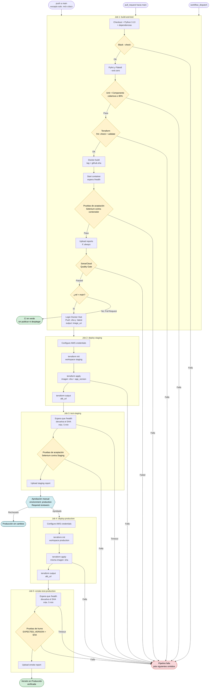
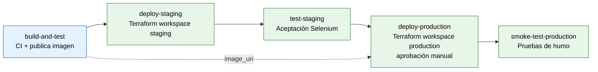
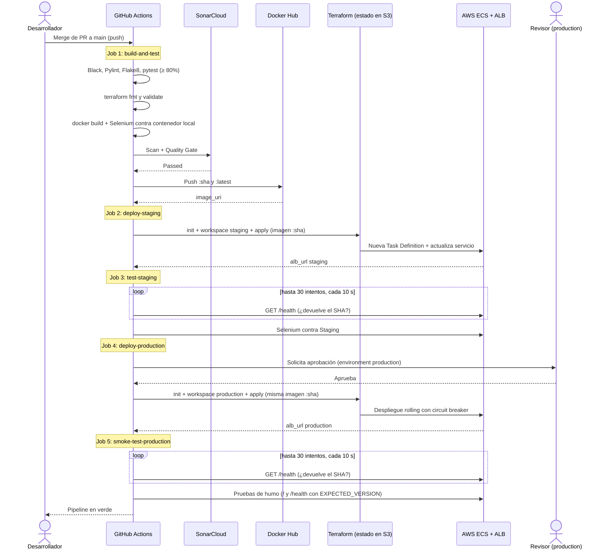

# Pipeline CI/CD – Entregable 3

Diagrama del workflow `.github/workflows/ci-cd.yml`: 5 jobs en cadena (CI + despliegue en Staging y Producción con Terraform sobre AWS ECS).

## Vista general

## Cadena de jobs

## Secuencia de ejecución

## Resumen de jobs

| # | Job | Depende de | Se ejecuta en | Qué valida o hace |
|---|---|---|---|---|
| 1 | `build-and-test` | — | push, PR y manual | Calidad, pruebas, Terraform fmt/validate, aceptación en contenedor, Quality Gate y publicación de la imagen (solo `main`) |
| 2 | `deploy-staging` | 1 | Solo `main` | `terraform apply` en workspace `staging` con la imagen `:sha` |
| 3 | `test-staging` | 2 | Solo `main` | Espera la versión nueva y ejecuta pruebas de aceptación contra Staging |
| 4 | `deploy-production` | 1 y 3 | Solo `main` | Aprobación manual (7.11) y `terraform apply` en workspace `production` con la misma imagen |
| 5 | `smoke-test-production` | 4 | Solo `main` | Espera la versión nueva y ejecuta pruebas de humo con `EXPECTED_VERSION` |

## Política de fallos

| Paso | ¿Detiene el pipeline? | Se ejecuta en |
|---|---|---|
| Black (`--check`) | Sí | push y PR |
| Pylint y Flake8 | No por hallazgos (`--exit-zero`) | push y PR |
| Pruebas unitarias y de componente (≥ 80%) | Sí | push y PR |
| Terraform `fmt -check` y `validate` | Sí | push y PR |
| Build y arranque del contenedor | Sí | push y PR |
| Pruebas de aceptación en el contenedor (Selenium) | Sí | push y PR |
| SonarCloud Quality Gate | Sí | push y PR |
| Login y push a Docker Hub | — | Solo `main` (push y manual) |
| `terraform apply` en Staging | Sí | Solo `main` |
| Espera de `/health` y aceptación en Staging | Sí | Solo `main` |
| Aprobación manual de `production` | Si se rechaza, Producción queda sin cambios | Solo `main` |
| `terraform apply` en Producción | Sí | Solo `main` |
| Espera de `/health` y pruebas de humo en Producción | Sí | Solo `main` |
| Show container logs | — | Solo si hay fallo (`failure()`) |
| Upload de reportes | — | Siempre (`always()`) |

## Configuración requerida en el repositorio

| Tipo | Nombre | Para qué se usa |
|---|---|---|
| Secreto | `SONAR_TOKEN` | Análisis de SonarCloud |
| Secreto | `DOCKERHUB_TOKEN` | Push de la imagen |
| Secretos | `AWS_ACCESS_KEY_ID`, `AWS_SECRET_ACCESS_KEY`, `AWS_SESSION_TOKEN` | `terraform apply` en los dos ambientes |
| Variable | `DOCKERHUB_USERNAME` | Nombre de la imagen y login |
| Variable | `SONAR_HOST_URL` | `https://sonarcloud.io` |
| Ambiente | `production` con **Required reviewers** | Aprobación manual (sección 7.11) |
| Ruleset | `proteger-main` | 1 aprobación y check `build-and-test` |

## Detalles clave

- **Misma imagen en todo el flujo:** se construye una vez, se prueba en el runner, se publica con el tag `github.sha` y esa misma imagen se despliega en Staging y Producción.
- **`concurrency` con `cancel-in-progress: false`:** una ejecución nueva espera a la anterior, para no interrumpir un `terraform apply`.
- **Aprobación manual (sección 7.11):** convierte el Despliegue Continuo en Entrega Continua. Staging sigue automático y Producción espera a los revisores.
- **Rollback (sección 8):** ECS usa circuit breaker. Si el despliegue falla, revierte a la versión anterior, y `/health` sigue mostrando el SHA viejo, lo que hace fallar el paso de espera.
- **Política de fallos:** si un job falla, los siguientes se omiten. Los pasos `failure()` y `always()` (logs y reportes) sí se ejecutan.
